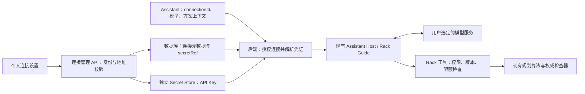

# Rack Assistant：Agent 与个人 API 接入调研

日期：2026-10-29，第二十四轮。本文是调研结论和待实现设计，不表示设置页或个人模型连接已经上线。

后续进展：第二十五轮已实现每账号一条连接的本地首次配置切片，见 [首次配置与持久连接](RACK_ASSISTANT_CONNECTION.md)。下文保留调研当时的事实与完整建议，多连接/数据库元数据等仍非本轮能力。

范围：阅读公开源码、官方文档及本项目现有实现；未部署外部项目、复制外部实现、配置真实凭证或调用付费模型 API。DrClaw 的结论固定在下文列出的 commit，外部项目后续版本可能变化。

## 1. 推荐结论

采用“个人模型连接 + 固定 Rack Agent + 后端业务工具”。先复用现有 Assistant，不另建多 Agent 平台，也不为接 API 引入 Python 或额外的模型网关服务。

- **模型连接**解决“向哪一个服务、用哪一个模型、谁的 Key 发送请求”。一个用户可以有多条连接。
- **Rack Agent**解决“助手负责什么、能调用哪些工具、执行有什么限制”。首版保持现有 Rack Guide 和工具白名单。
- **会话/运行**解决“谁在什么方案版本上提问、用了哪条连接、执行了什么、是否取消、消耗多少”。

用户换模型服务通常只需换连接，不需要重新创建 Agent；新增连接也不会自动授予更多项目权限。

## 2. 外部项目如何做

### DrClaw（龙虾博士）

核查版本：`InternScience/DrClaw@4f96df0d9df0eae24a992afabe08edec5fc575f0`。

| 方面 | 源码/文档所示行为 | 对 Rack 的启发 |
| --- | --- | --- |
| 接入信息 | Provider 有 `api_key`、`api_base`、`model`，可选 reasoning 配置 | 给用户明确的连接表单，不让其改代码 |
| 多连接 | `providers` 字典加 `active_provider` 指定当前连接 | 将连接管理与 Agent 任务管理分开 |
| 配置入口 | 本地 `~/.drclaw/config.json`，Web 设置也可编辑连接字段 | 提供可操作的设置入口 |
| 生效方式 | Web 保存返回 `restart_required: true`，界面提示重启 daemon | 不能把该版本描述成已支持即时热切换 |
| 调模型 | LiteLLM 适配层传递模型、地址、Key 和 tools，统一结果 | 借鉴适配器边界；Rack 已有自己的适配器 |
| Agent 管理 | Registry 管理标识、类型、标签、任务及 RUNNING/DONE/ERROR；主 Agent 路由任务 | 首版可显示运行/失败/取消和工具过程，无需照搬科研团队组织 |
| 多 Agent | 文档中的单 Project 多 Agent 功能标注测试中，共享 workspace、分开记忆/会话 | 复杂多 Agent 并非 Rack 接入模型的前提 |

凭证处理需要区分使用环境：核查版本的 `save_config` 将配置写为普通 JSON；配置接口和表单路径还会返回、回填 Key。这符合其本地个人控制台的使用方式，但不能直接照搬成我们多人服务器上的个人凭证接口。这里仅说明所读路径，不是对整个项目的安全审计。

DrClaw 的 `openai/…` 等模型前缀属于其 LiteLLM 路由约定；Rack 当前直接请求兼容接口，应使用服务商要求的模型 ID，不能自动加这个前缀。此次没有证据证明每个 Agent 都有独立 Key，也没有确认其设置页提供连接测试。

### Open WebUI

官方文档展示了两条不同路线，不能混为一种 Key 保存方式：

| 路线 | 用户操作与请求路径 | 适用启发 |
| --- | --- | --- |
| 管理员连接 | 管理员在 Connections 添加 URL、Key 和模型；由后端连接服务商 | 连接表单、启用/禁用、模型手填与发现可借鉴 |
| Direct Connections（实验性） | 管理员启用后，用户添加个人连接；Key 存在浏览器 localStorage，推理请求由浏览器直达服务商 | 无需服务器保存个人 Key，但依赖服务商 CORS，Key 对浏览器脚本可见 |

官方文档也说明：验证连接通常使用 `/models`，部分服务商不提供这个接口，因此“模型列表获取失败”不等于“聊天不可用”。应保留手填模型 ID。兼容接口的工具调用能力也有差异，普通聊天成功不能代替 Agent 验收。

Rack 推荐后端代理，因为权限、方案版本检查、工具调用和审计已经在后端。浏览器直连不是首版路线。Open WebUI 的 Direct Connections 描述不代表其所有模式都在浏览器保存 Key，也不代表所有后台功能都在浏览器执行。

### 额外源码参考：LibreChat

其 `librechat.example.yaml` 展示自定义连接的地址、Key、模型列表配置，并明确提及用户提供地址时的 SSRF 校验及管理员允许的内网地址规则。本轮只将其作为连接 schema/地址校验的辅助参考，没有核实其个人 Key 存储或管理界面的完整行为。

## 3. 我们的用户应该怎样使用

1. 打开“设置 → AI 模型连接 → 新增连接”。
2. 填连接名称、协议、Base URL、API Key、模型 ID。首版协议只支持现有 OpenAI-compatible Chat Completions。
3. 可先获取模型列表，也可直接填写服务商给出的模型 ID。
4. 点击测试，分别显示地址/认证、模型请求、工具调用的结果。实际生成与工具往返测试会产生少量模型用量，按钮旁说明即可；测试采用合成消息，不发送真实机房资料。
5. 保存并设为“我的默认连接”。保存后列表只显示已配置 Key 的状态，不再返回 Key。
6. 在 Plan 中打开 Assistant，选择“我的连接 · 模型”，询问容量、布局问题或请求候选。
7. 后续接入自动设计时，助手整理需求，调用既有确定性算法生成候选；用户预览、确认转草稿后，通过原保存流程提交。

例如用户说“要放 12 台 GPU 服务器和 4 台交换机，功率不超过 40kW”，助手应先明确型号、单柜限制、房间预算来源等缺失输入，再调用规划服务；几何布置和容量计算交给领域算法与后端检查器。

### 两种部署下的“自己的 API”

- **每位组员各自本地运行**：各自配置连接和 Key。Git 拉取只带代码/模板，不同步凭证；同一个仓库不代表共用一个模型账号。
- **共用一套服务器**：按已认证用户保存连接归属，每人只使用自己获授权的连接。项目成员关系不能隐式授予他人的个人 Key。团队共享连接以后作为独立管理员功能设计。

## 4. 建议架构

模型服务会收到本轮必要的提示与工具结果，应在连接启用时说明数据会发送到所选服务。后端控制返回字段、分页和大小，不能把整个数据库或任意其他项目上下文发送给模型。

### 建议数据与接口边界（未实现）

| 对象 | 建议最小字段 |
| --- | --- |
| Connection | id、ownerUserId、name、protocol、endpoint、defaultModel、allowedModels、secretRef、enabled、version、创建/更新时间 |
| ConnectionTest | connectionId/连接版本、测试时间、认证/模型/工具各阶段结果；不记录 Key 或未经处理的上游响应 |
| Agent | 复用 rack-guide 版本、工具白名单、预算；首版无需通用 Agent 编辑器 |
| Session/Run | 认证用户、项目/场景/revision、planId/方案版本、connectionId/连接版本、model、消息、工具轨迹、用量与状态 |

接口名称先作为设计草案，实施前需要补充到既有规范并确定响应封装：

| 接口草案 | 责任 |
| --- | --- |
| `GET /api/v1/assistant/connections` | 仅返回调用者获授权的连接元数据与 hasKey；不返回 secretRef 或 Key |
| `POST /api/v1/assistant/connections` | 校验连接，写入独立凭证存储和元数据；Key 只在此显式配置流程中提交 |
| `PATCH /api/v1/assistant/connections/:id` | 修改本人连接、轮换 Key、启停；版本条件更新，未提交 Key 表示保留，不能用掩码覆盖 |
| `POST /api/v1/assistant/connections/:id/test` | 按用户授权与连接版本进行分阶段测试；超时、限额和错误脱敏 |
| `DELETE /api/v1/assistant/connections/:id` | 禁用并撤销凭证，处理默认连接与在途请求；历史会话保留非敏感引用 |
| 现有 `POST /api/v1/assistant/chat` 扩展 | 只接受已登记的 connectionId 和允许的 model；不接受临时 Key、任意 endpoint 或 provider 实现 |

连接创建涉及数据库与 Secret Store 两处写入，需规定失败补偿、凭证撤销与无效状态处理，不能成功一半却对用户显示已可用。

### 与现有安全设计对齐

现有 [蓝图 §4.2](doc/workspace/chatbox-llm-architecture-blueprint.md#42-provider-abstraction) 以部署配置选择 provider，并规定 Key 不来自聊天请求。个人连接属于扩展设计：实现前需更新规范，明确“连接管理接口接收一次配置凭证”和“聊天只引用服务器登记连接”的区别；服务端仍控制适配器实现、权限和工具。

现有 [secrets 包](packages/secrets/src/index.js) 要求凭证位于应用外部，不放数据库、镜像、日志或 trace。数据库只存 secretRef。首版若做本地可写凭证存储，需独立受限目录、适当加密和外置主密钥，并新增写入/轮换/删除接口；目前的环境变量/文件 provider 只有读取能力，不能当作已支持 UI 保存 Key。

## 5. 本项目已有基础与缺口

| 位置 | 已有能力 | 本次接入要补什么 |
| --- | --- | --- |
| [provider.js](packages/assistant/src/provider.js) | 兼容 Chat Completions、工具请求、超时、响应检查与谨慎重试 | 从授权连接构建适配器；实际测试工具往返能力 |
| [assistant-host.js](apps/api/src/assistant-host.js) | Rack/Facility surfaces、Guide、RBAC、上下文、审计、预算；部署级 provider 缓存/脱敏 | 请求级连接解析及凭证脱敏，按连接版本隔离缓存 |
| [assistant 路由](apps/api/src/routes/assistant.js) | provider 元信息、模型白名单、聊天/轮次进展、取消 | 个人连接 CRUD/测试；聊天授权 connectionId |
| [config.js](packages/core/src/config.js) | LLM_PROVIDER/ENDPOINT/MODEL/MODELS/API_KEY_SECRET 等部署配置 | 保留管理员部署连接作为可选来源，不静默回退到其他人的 Key |
| [secrets 包](packages/secrets/src/index.js) | env/file 读取与缓存 | 可写凭证存储及轮换、撤销、缓存失效 |
| [useAssistantSession.js](apps/web/src/assistant/useAssistantSession.js) | 模型选择、会话、上下文切换隔离 | 连接设置与选择；将连接身份纳入会话隔离 |
| [Rack 工具接线](RACK_ASSISTANT.md) | 列方案、读方案、容量、检查、布局候选，共 5 个工具 | 后续增加设备需求/自动设计工具投影，复用既有领域服务 |

重要实现差异：当前 provider 的 endpoint 是完整 `/chat/completions` URL。设置页若使用更常见的 Base URL，必须统一规范化，避免重复拼接 `/v1` 或 `/chat/completions`；模型 ID 保持服务商原值。

当前 Rack 工具只读保存版或生成临时候选，没有聊天保存/删除工具，也未接通按设备数量自动设计的 Assistant 工具。现有前端自动设计能力不等于已经能从聊天调用。

## 6. 实施时必须落地的边界

1. 连接归属由认证用户决定；猜到 connectionId 不能访问或测试他人连接，项目权限仍独立检查。
2. 不通过修改全局 provider 切换用户连接。轮换 Key 要使旧缓存和脱敏器失效；并发用户不能串 Key。
3. Key 不进入 localStorage、聊天、模型提示、数据库业务字段、响应、错误或审计。设置输入只在显式保存请求中提交，服务端后续不回填原值。
4. 自定义地址要校验协议、TLS、DNS解析结果及重定向目标，禁止 URL 用户名/密码和含凭证的 query。校园内网网关由管理员明确允许相应目标范围，不能无条件开放任意地址；默认验证证书。
5. 切换连接/模型应停止旧请求并切换会话身份；不能把未完成响应写进新会话。删除/禁用连接后给出明确状态，不自动使用公共 Key。
6. 分开显示“已保存”“普通聊天可用”“工具调用可用”。`/models` 不支持时允许手填；普通兼容接口不一定支持完整 tools 往返。
7. 配额、超时、取消、审计沿用现有 Host。展示服务返回的实际用量；未知价格时不编造金额。遇到响应或超时不自动重复可能已计费的调用。

## 7. 推荐开发先后与验收

| 顺序 | 可交付内容 | 验收依据 |
| --- | --- | --- |
| 1 | 补连接/凭证/会话扩展规范，再做后端连接元数据和 Secret Store | 假凭证覆盖隔离、脱敏、轮换、删除、失败补偿、地址校验；无需真实付费 API |
| 2 | “我的模型连接”表单、列表、手填模型与分级测试 | 新建/修改/取消/设默认/删除链条通；Key 不回显，测试与保存状态区分 |
| 3 | Assistant 选择连接，请求级 provider 与会话隔离 | 两用户并发不串连接；换连接/模型取消旧轮；既有 Rack 权限、版本、工具限额不退化 |
| 4 | 用用户自行配置的一个真实服务验收 Rack 对话 | 读取容量→工具结果→可追溯回答；真实工具往返、限流/无效 Key/取消；此时才需要凭证 |
| 5 | 将已有按数量自动设计投影为 Assistant 工具 | 需求缺项澄清、调用确定性算法、候选说明；明确确认与普通保存链，不悄悄写库 |

第一版暂不做任意 Agent 创建、Agent 团队协作、后台常驻任务、定时自主执行、OAuth 订阅复用或聊天直接保存/删除。这些不是当前 Rack 课程目标所必需；先把个人 API 接入和现有工具完整打通。

## 8. 来源

- [DrClaw README（固定版本）](https://github.com/InternScience/DrClaw/blob/4f96df0d9df0eae24a992afabe08edec5fc575f0/README.md)
- [DrClaw 用户手册](https://github.com/InternScience/DrClaw/blob/4f96df0d9df0eae24a992afabe08edec5fc575f0/docs/USER_MANUAL.md)
- [DrClaw 配置 schema](https://github.com/InternScience/DrClaw/blob/4f96df0d9df0eae24a992afabe08edec5fc575f0/drclaw/config/schema.py)、[配置加载/保存](https://github.com/InternScience/DrClaw/blob/4f96df0d9df0eae24a992afabe08edec5fc575f0/drclaw/config/loader.py)
- [DrClaw Web 配置路由](https://github.com/InternScience/DrClaw/blob/4f96df0d9df0eae24a992afabe08edec5fc575f0/drclaw/frontends/web/routes.py)、[Web 表单](https://github.com/InternScience/DrClaw/blob/4f96df0d9df0eae24a992afabe08edec5fc575f0/drclaw/frontends/web/static/index.html)
- [DrClaw LiteLLM provider](https://github.com/InternScience/DrClaw/blob/4f96df0d9df0eae24a992afabe08edec5fc575f0/drclaw/providers/litellm_provider.py)、[Agent registry](https://github.com/InternScience/DrClaw/blob/4f96df0d9df0eae24a992afabe08edec5fc575f0/drclaw/agent/registry.py)
- [Open WebUI：连接兼容服务](https://docs.openwebui.com/getting-started/quick-start/connect-a-provider/starting-with-openai-compatible/)
- [Open WebUI：Direct Connections](https://docs.openwebui.com/features/chat-conversations/direct-connections)
- [LibreChat：配置示例（浮动 main，仅辅助参考）](https://github.com/danny-avila/LibreChat/blob/main/librechat.example.yaml)

外部引用用于解释设计思路，不替代本项目的实现与测试。没有核实的第三方功能不作为既成能力；真实模型对业务问题的回答质量仍待后续验收。
