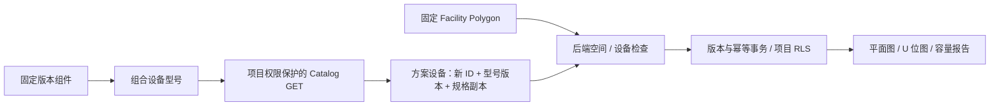

# Catalog 与 Rack 集成

2026-10-28。只改 AI-INFRA-Rack 副本，不连接或修改老师平台。参考老师截图的模块结构，没有导入线上目录数据。

## 查看和使用

打开 http://localhost:5193/，进入项目：

- **Catalog → Models**：5 个型号，查看组件组成、固定版本、整机规格和字段来源。
- **Catalog → Technologies**：11 个组件版本，可搜索/按类型筛选。
- **Catalog → Rule examples**：正常上架、U 位冲突、功率超限、规格未知四类只读示例；调用真实设备检查器，不改方案。
- **Rack → Edit layout → Equipment → Add from catalog**：选型号，添加未上架设备，选择机柜/起始 U，再 Save layout。原有手填设备仍支持。
- **主画布**：Expand map 展开，Esc 退出；Fit room 看整房，Fit racks 聚焦机柜；Color by 查看布局、已知 U 占用或功率。障碍/维护带开关只影响显示，隐藏不取消检查。已有机柜默认聚焦显示。

俯视图表达机柜摆放，柜内立面表达 U 位。没有新增 Network 拓扑、3D 或热仿真。

## 架构与契约



- `packages/rack/src/catalog.js` 是随代码发布的只读参考数据，与领域规则、HTTP、UI 分离。没有独立目录数据库、编辑/审批服务或微服务。
- 型号引用组件的精确版本；只有 U 高度由机箱派生。重量/电力/冷却是独立整机假设，未知保持 null。PSU 额定输出不等于整机功耗，冷板额定散热不等于柜级预算。
- 全部标 ASSUMED / DEMO，不冒用 approved。组合清单不证明接口兼容、供电冗余或整机工程有效。
- 设备可选 `catalogRef: { modelId, version }`。后端 check/save 核对精确版本及 heightU/weightKg/powerKw/coolingKw；伪造、空引用、未知版本或规格不一致返回 400/RACK_INPUT_INVALID，不回退 latest。
- 固定引用时规格只读，名称和分配可改。Detach to custom assumptions 保留 ID/规格/安装、移除型号声明，之后允许改规格；不改目录。
- 已发布 v1 不可修改/删除；变更需新增版本并保留旧版。测试固定 v1 指纹。外部同步、信任和版本留存仍待实现。
- equipment 沿用 JSONB，同一版本、If-Match、幂等 key、来源锁、事务及强制项目 RLS。本轮无需迁移。旧设备省略 catalogRef 仍有效；旧客户端省略 equipment 保留存储值。

`GET /api/v1/projects/:projectId/rack/catalog` 需要 rack.read，返回 data/meta。data 包含 contractVersion=1、projectId、catalogRevision、source、models、technologies、examples、scope。没有写接口；未登录 401、无项目权限 403。目录内容是共享合成示例，但入口检查项目权限。Rack 保存仍需 rack.write + facility.read。

浏览器调用 API，不导入后端包。接口复用 correlation ID，不暴露开发凭据。现有 Assets 管文件附件，尚无全局硬件资产身份。

## 可重复演示

Rule examples 随代码提供，组员无需导入个人数据库。另提供独立六柜方案脚本：

```powershell
npm run rack:demo:catalog -- <本地项目UUID> <该项目已有方案UUID>
```

要求隔离栈已启动、已有来自 dev-seed-facility 的合成 HALL 方案、来源未变化、房间足够大。脚本只访问 localhost，检查隔离数据库配置；读取来源，通过正常 API 创建独立方案、检查和保存。重复执行使用相同创建 key，已有非空方案不覆盖。不执行 setup/seed/reset；失败可能留下独立空方案，不自动删除。

本机新增 **Rack catalog demo — six racks**，ID `e446aafb-1846-4a69-af10-636fd50ba87c`，v2，6 柜、17 台固定型号设备、一个禁放区、前 1 m/后 0.5 m 维护距离。均为假设。空间范围无冲突；部分设备规格未知，设备报告 INCOMPLETE、全局 NOT_RUN。原四个示例不改写。

着色按当前检查结果：蓝色低于 80%，黄色达到 80%，红色冲突/超限，灰色未知/未检查。80% 只用于显示，具体原因看诊断。

## 尚未实现

外部目录同步、编辑审批、全局硬件资产、机房正式预算、连续通道、布局候选、Rack Assistant、全局工程验证。下一步复用现有检查器做可解释候选，再接 Assistant。证据见 `records/2026-10-28-rack-catalog/`。
