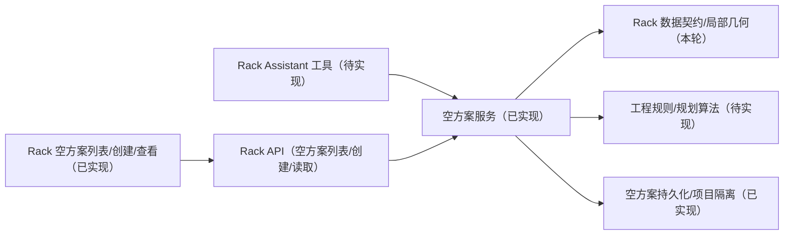

# Rack 基础设计与本轮边界

最新补充（2026-10-29，第十八轮）：[机房功率/冷却假设预算](RACK_ROOM_BUDGET.md) 已补齐来源、全柜安装/库存总量、未知/超限、旧客户端保留、原子保存/候选/自动上架共享检查。无新迁移，正式跨方案Facility分配仍待实现。连续通道、验证记录和性能实验是后续重点；下文各轮状态按当轮保留。

日期：2026-10-27。对应 [总清单](RACK_PROJECT_TODO.md) 的阶段 0–2，以及阶段 3 的领域包骨架。

本文区分已经实现的基础契约与后续设计方向。领域规则、空方案 API/持久化与工作区进展分别记录；这些增量不表示完整规划系统已经可用。
本轮进展和运行结果见 [PROGRESS.md](PROGRESS.md)。

可视化入口：当前平台工作区支持固定机房图面、机柜编辑保存、规划矩形禁放区与前后维护带，见 [布局](RACK_LAYOUT.md) 和 [空间约束](RACK_CONSTRAINTS.md)。[独立只读预览](RACK_PREVIEW.md) 保留为早期离线示例。

## 1. 本轮只做什么

最新补充（2026-10-29，第十七轮）：[设备自动上架](RACK_ALLOCATION.md) 已接通未分配设备的连续U/三种资源贪心分配、部分结果与原因、立面/容量预览和普通原子保存。[Rack Assistant](RACK_ASSISTANT.md) 注册了真实只读/候选工具；用户决定先不配模型，自然语言端到端待验收。没有迁移，旧示例保留。下方各轮内容为历史状态。

最新补充（2026-10-29，第十六轮）：[布局规划闭环](RACK_PLANNER.md) 已实现现有机柜的确定性重排、基线/启发式比较、完整规则复核、预览与确认转共享草稿后保存。复用版本/来源锁/幂等/权限，无迁移；历史章节中的未实现状态按当轮保留。设备自动装箱、正式预算/通道、候选历史和 Assistant 仍未实现。

第十三轮新增本地只读 Catalog、设备型号版本绑定和画布增强，见 [RACK_CATALOG.md](RACK_CATALOG.md)。目录/领域/API/UI 分层，复用原保存事务；没有新迁移或老师平台接入。

已经实现：

- 独立 `@ai-infra/rack` 领域包，无数据库、网络或前端依赖。
- Rack Model 与 Rack Placement 的输入检查和不可变返回值。
- 以机柜中心为位置的局部坐标几何计算，保留物理正面方向。
- 明确未知容量、数据来源和结构错误的表达。
- 可重复运行的纯单元测试和合成示例。
- 空 Rack Plan 的内存构造、设施来源引用和引用变化比较（第二轮补充，见第 9 节）。
- 矩形机房输入副本，以及单个机柜的越界/障碍检查（第三轮补充，见第 10 节）。
- 多柜清单的声明归属/型号引用检查、柜间占地碰撞及结构化汇总（第四轮补充，见第 11 节）。

2026-10-28 已另在 API 服务层补空方案表、rack.read/write、创建/读取/有上限分页 HTTP API，见 [RACK_API.md](RACK_API.md)；已接通工作区空方案列表、创建与详情，见 [操作说明](RACK_WORKSPACE.md)。领域包仍不依赖数据库或 app。
第十轮新增固定 Polygon 快照、机柜存储/保存与手工编辑、PostGIS 局部空间检查、独立版本及保存幂等；见 [RACK_LAYOUT.md](RACK_LAYOUT.md)。尚未实现设备分配、完整约束引擎、布局算法、候选应用、Rack Assistant、正式验证和发布。
第九轮已接入只读 HALL 平面图，支持受限 UTM 投影 Polygon 平移为局部米制，见 [几何/坐标 contract](RACK_FLOORPLAN.md)。它不是矩形规则引擎的输入快照。
第十一轮增加规划矩形禁放区、前后维护净距、图面与诊断定位及同事务保存；见 [RACK_CONSTRAINTS.md](RACK_CONSTRAINTS.md)。这些仍是假设输入，不是设施权威障碍图或工程认证。

## 2. 首版业务范围的设计方向

- 一个 Rack Plan 规划一个机房；多机房以后通过多个方案组合，不隐式共享坐标。
- Rack 读取机房权威边界，拥有机柜位置与设备分配，不修改设施边界。
- 首版二维布局；手工和算法使用 0/90/180/270 度方向。
- 后续支持锁定机柜，布局算法不能悄悄移动被锁定对象。
- 型号规定尺寸与限制；实例规定身份、所属方案、位置和方向，二者分离。
- 前端提示、算法候选和 Assistant 必须最终调用同一后端规则与命令。
- 型号来源必须明确；本轮合成示例不是厂商规格或工程认证。

这些业务方向已记录，但设备、机房、预算和净距的完整契约仍待后续补齐。

## 3. 已实现的数据契约 v1

### 3.1 Rack Model

| 字段 | 类型与单位 | 规则 |
| --- | --- | --- |
| `modelId` | UUID 字符串 | 规范化成小写；后续不应改变既有实例引用的型号内容 |
| `name` | 字符串 | 去除首尾空白；原始长度不超过 160；不能为空 |
| `widthM` / `depthM` | 数字，m | 有限正数，不接受数字字符串 |
| `heightU` | 数字，U | 正的安全整数；表示安装容量，不等于整个机柜外部高度 |
| `maxWeightKg` | 数字，kg，或 null | 非负有限值；缺失时转为 null |
| `maxPowerKw` | 数字，kW，或 null | 非负有限值；缺失时转为 null |
| `maxCoolingKw` | 数字，kW，或 null | 非负有限值；缺失时转为 null |
| `source.kind` | ASSUMED / REFERENCE | 假设或外部参考；REFERENCE 不代表已经审核 |
| `source.reference` | 字符串 | 非空，原始长度最多 512，描述来源 |

`null` 表示未知，`0` 表示显式没有相应容量，不表示无限容量。构造函数不自动填入常见机柜容量，不把假设升级为已确认值。

### 3.2 Rack Placement

| 字段 | 类型与单位 | 规则 |
| --- | --- | --- |
| `rackId` / `planId` / `projectId` / `modelId` | UUID 字符串 | 必填、规范化；是否属于同一项目由未来服务层校验 |
| `name` | 字符串 | 与型号名称相同的长度与非空规则 |
| `xM` / `yM` | 数字，m | 机柜占地中心，有限数值；负坐标在数据层允许，是否越界以后按机房检查 |
| `rotationDeg` | 0 / 90 / 180 / 270 | 缺失时为 0；显式 null 或字符串拒绝 |
| `locked` | 布尔 | 缺失时为 false；显式 null 或字符串拒绝 |

记录包含项目标识不等于完成授权；锁定字段存在也不代表布局算法已实现。

### 3.3 构造和错误规则

- 接受 JSON 对象，拒绝数组、空对象缺少必填值、未知字段和非法数值。
- 不将数字字符串、null、NaN 或 Infinity 静默转换成有效参数。
- 构造输出及嵌套来源为冻结对象，与调用者输入分离；构造不修改输入。
- 输入错误为 `RackInputError`，包含 `code = RACK_INPUT_INVALID` 和 `details: [{ field, reason }]`。
- 领域错误本身不依赖 HTTP；现有空方案路由将其映射为 400，尚未实现对所有错误一次性汇总。
- `CONTRACT_VERSION = 1` 对应示例封装中的 `contractVersion`。当前不接收网络文档，未来 API 必须另检查封装版本。

示例：[basic-rack.json](packages/rack/examples/basic-rack.json)。型号和实例的完整字段可以直接在该文件中查看。

## 4. 坐标与几何约定

- 每个机房采用独立局部笛卡尔平面，长度为米；X 向右、Y 向上。
- `(xM, yM)` 表示机柜中心，旋转为绕中心逆时针旋转。
- 0 度时宽度沿 X 轴、深度沿 Y 轴；正面为局部 -Y 边。
- 0 度角点依次为左前、右前、右后、左后；旋转保持角点的物理身份。
- 前端屏幕 Y 向下时只在显示层转换，不能改变存储坐标的约定。
- `rackFootprint` 返回 `cornersM`、`frontEdgeM` 和 `boundsM`；四个角点不重复闭合，不是 GeoJSON。
- 使用精确四分之一转系数，避免 90 度三角函数带来的微小误差。
- 拒绝溢出或因浮点精度导致占地退化的输入；普通浮点结果仍需要未来空间规则定义容差。
- 已实现 WGS84 UTM 投影到局部坐标的只读平移，原点为外环 min easting/min northing，X/Y 为网格东/北；屏幕反转 Y。保留 Polygon 及孔洞，不降级为包围框。固定 Polygon 输入快照已落地；任意 CRS 转换与墙轴旋转仍未实现。
- 已增加矩形机房包含、矩形障碍与柜间占地重叠检查；实际 Polygon 的包含/孔洞/柜间碰撞、规划矩形禁放区与前后维护带由 PostGIS 服务处理；侧面净距、连续通道与容量尚未实现。返回几何不代表方案工程有效。

## 5. 版本策略（原始设计，现已部分落地）

优先采用独立 Rack Plan 版本，显式绑定设施输入快照，避免 Facility 验证通过时直接冻结 Rack 设计。
这是本轮的初始设计选择，必须在持久化阶段验证工作区和 Assistant 的兼容性后再定稿。

后续需做到：

1. 方案记录 `projectId`、`scenarioId`、`planId`、自身版本和上游设施 revision/container。
2. 设施草稿引用必须额外记录输入 ETag/内容标识；正式冻结输入固定引用。
3. Rack 修改只推进 Rack Plan 版本，不回写或解冻设施 revision。
4. Facility 验证状态与 Rack 验证状态分别表达，不能合并为无范围的“已通过”。
5. 上游边界/预算变化，或方案修改，使旧验证与候选失效。
6. 候选应用按基准版本条件更新；旧版本和重复请求应按 contract 处理。
7. 工作区归属和方案版本分离；尤其要修改现有 Assistant 直接从 Facility revision 推导只读状态的逻辑。

第二轮已增加空 Rack Plan 构造器和设施 revision ETag 引用比较，但没有状态修改命令、Rack 并发 ETag、校验记录或保存实现。
Rack Plan 的初始 `version = 1` 不等于上游设施的 ETag，也不表示已经持久化。

## 6. 后续模块边界



浏览器通过 API 访问 Rack 服务，不直接导入后端 package；领域包不反向导入 app。空方案服务在 `apps/api/src/services/rack-plans.js`，路由负责 HTTP 适配并沿用权限 guard；工作区的首个空方案切片在 `apps/web/src/rack/`。

## 7. API 进展与后续草案

已实现 `/api/v1/projects/:projectId/rack/plans` 的 POST、GET 分页列表和 `GET /:planId`，准确 contract 见 [RACK_API.md](RACK_API.md)。下表其余操作仍是草案。

| 操作方向 | 建议方法/资源 | 关键前提 |
| --- | --- | --- |
| 创建/读取方案 | POST / plans；GET / plans/:planId | 项目权限、机房与上游来源校验 |
| 提交变更集 | POST / plans/:planId/changes | If-Match、原子事务、幂等、输入检查 |
| 校验 | POST / plans/:planId/validate | 固定方案/来源版本，报告未检查项 |
| 生成候选 | POST / plans/:planId/candidates | 只生成建议，不直接保存为正式方案 |
| 应用候选 | POST / plans/:planId/candidates/:candidateId/apply | 确认、重新授权、版本与来源复核 |

HTTP 成功/错误沿用平台响应封装和 correlation ID；已注册 `rack.read`、`rack.write`。`rack.validate.run`、`rack.plan.run` 仍未注册或实现。

空方案请求/响应、列表分页、幂等创建、真实来源引用和拒绝行为已记录；变更并发控制、容量、设备、完整删除策略、任务和完整安全审计仍待设计。

## 8. 下一个小阶段

2026-10-28 用户恢复平台初始化并允许 Docker，平台已通过独立栈运行，见 [本地运行说明](RACK_LOCAL_SETUP.md)。工作区现已完成固定 HALL 快照、可保存机柜编辑、矩形禁放区和前后维护带。显式重绑定仍待做。
Rack 专用存储包含方案、快照、机柜、命令记录和规划约束；Compose 项目名、数据卷和端口均已隔离。下一小步应补设备规格、U 位分配与容量的契约及最小闭环。

第十二轮已完成上述设备/U 位/容量假设闭环，当前以 [RACK_EQUIPMENT.md](RACK_EQUIPMENT.md) 为准；下一小步是可解释布局候选，正式预算/依赖及 Assistant 仍待做。

下一轮只选一个小闭环；不同时展开 UI、完整算法和 Assistant。

## 9. 第二轮：空方案与设施来源 contract（已实现，无数据库）

### 9.1 三个离线 API

| API | 输入 | 返回/用途 |
| --- | --- | --- |
| `createFacilityInputReference(input)` | 下表的设施引用 | 规范化 UUID、检查 ETag、返回冻结副本 |
| `createRackPlan(input)` | `planId`、`projectId`、`scenarioId`、`name`、`facilityInput` | 创建空内存草稿；不是数据库创建接口 |
| `assessFacilityInput(previous, current)` | 两个设施引用 | 比较来源身份及版本标记；不访问设施服务 |

创建输入示例见 [empty-plan.json](packages/rack/examples/empty-plan.json)，它的全部标识与 ETag 都是合成值。
`planId` 由调用方提供；未来网络请求应由服务端按最终 API contract 分配身份，不应直接信任客户端。

设施引用：

| 字段 | 规则与含义 |
| --- | --- |
| `projectId` / `scenarioId` | UUID，必须分别与方案声明的项目/场景相同 |
| `revisionId` | 上游设施 revision 的 UUID |
| `containerId` | 上游机房 container 的 UUID；本轮不查询其类型或实际归属 |
| `revisionEtag` | 必填，不透明、区分大小写，最多 512 字符；拒绝控制字符和首尾空白，不静默 trim |

新方案始终输出 `contractVersion: 1`、独立 `version: 1`、`state: DRAFT`、`validationState: NOT_RUN` 和空 `placements`。
这些值不能通过创建输入覆盖。空方案没有诊断，仍然是“未检查”，不能显示成“验证通过”。
返回值、引用与数组均冻结；构造不修改输入。输出可以 JSON 序列化，但本轮没有文件/数据库保存或读取已存方案的实现。
构造器只接收创建参数，不能把输出文档原样传回当作反序列化校验器。

### 9.2 来源变化的语义

| 比较结果 | 条件 | 后续服务应如何解释 |
| --- | --- | --- |
| `UNCHANGED` | 四个身份字段与 ETag 相同 | 本次提供的引用相同；不表示工程可行或权限有效 |
| `STALE` | 身份相同、ETag 不同 | 上游版本标记已变化，旧校验/候选不能继续当作当前结果 |
| `DIFFERENT_SOURCE` | 项目、场景、revision 或机房任意一个不同 | 不是同一个来源，不能作为对原引用的普通版本刷新 |

返回 `{ status, changedFields }`。身份变化优先于 ETag 变化，多个身份字段变化会全部列出。
UUID 大小写不制造差异；ETag 大小写会制造差异。
比较函数不自动重绑方案、不推进方案版本、不获取最新数据，也不改动上游。

### 9.3 仍然需要服务层解决的事

- 相同的自报项目 ID 只能保证结构一致，不能代替认证、权限、真实外键/归属校验。
- `current` 必须来自服务端重新读取的权威设施数据，不能由客户端自行声明“最新”。
- revision 级 ETag 可能因其他设施修改而变化，因此本轮比较是保守失效依据，不是机房内容 checksum。
- 如果上游修改没有正确推进 ETag，本函数无法发现；之后要检查所有修改路径与输入快照覆盖范围。
- 此引用不是边界快照，没有几何、原点、坐标转换或预算；不能直接用于机柜可行性检查。
- 本轮仅支持带 revision ETag 的引用；不可据此声称冻结/发布输入的 checksum 绑定已经完成。
- 没有 Rack Plan 更新命令、并发控制、幂等、持久化、HTTP 或 Assistant 集成。

测试命令：`npm run test --workspace @ai-infra/rack`，第二轮共 32 项通过（原有 17 项 + 新增 15 项）。

## 10. 第三轮：矩形机房输入与单柜空间检查（已实现，离线）

### 10.1 支持范围与输入

`createRoomSnapshot(input)` 创建不可变的本地输入副本。它不是数据库快照，也不验证内容 hash。
仅支持轴对齐矩形机房及矩形障碍；**不能把 L 形或带孔机房的包围框当成真实可用边界**。
本轮不接受多边形，未来应使用明确的多边形 contract，不能悄悄做包围框降级。

合成样例见 [rectangular-room.json](packages/rack/examples/rectangular-room.json)：10m × 8m，含一个矩形禁放区。

| 字段 | 规则与含义 |
| --- | --- |
| `contractVersion` | 必填，当前为数字 1 |
| `snapshotId` | UUID，由调用方提供；不保证这个 ID 与内容一一对应 |
| `facilityInput` | 第 9 节的完整来源引用，保留上游身份与版本标记 |
| `name` | 非空文本，最多 160 字符 |
| `unit` / `frame` | 必须显式为 `m` / `ROOM_LOCAL`，不默认接受经纬度、毫米或投影坐标 |
| `originDescription` | 非空文本，最多 512 字符；说明本房间原点，沿用 X 右、Y 上约定；不是可执行的地理转换参数 |
| `boundaryM` | `{ minX, minY, maxX, maxY }`，矩形边界，所有值为有限数字，两个方向跨度都必须有限且大于零 |
| `obstacleCoverage` | 显式 `COMPLETE` 或 `UNKNOWN`，不允许缺失时自动认为没有障碍 |
| `obstacles` | 必填数组，最多 256 个；每项含 UUID `obstacleId`、非空 `name`、矩形 `boundsM` |
| `source` | `kind: ASSUMED / REFERENCE` 与非空 `reference`；REFERENCE 不代表经过工程审核 |

障碍必须全部位于房间内，可以贴墙；不同障碍可重叠，但 UUID 规范化后不能重复。
拒绝空洞数组、未知字段、反向/退化/溢出边界。返回值各层冻结，与调用者输入隔离，支持通过该构造器检查 JSON 往返数据。
`COMPLETE` 是调用方对这份输入的声明；样例中的 COMPLETE 只是合成场景假设，未调查真实机房。

### 10.2 单个机柜的两项规则

`checkRackPlacement(room, model, placement)` 先检查输入和声明的项目一致性，再复用现有四方向占地计算。
它不修改方案，也不把结果写入方案的 `validationState`。

| 稳定 rule ID | 规则 | 失败诊断 code |
| --- | --- | --- |
| `rack.space.room_bounds` | 整个机柜占地必须落在矩形机房内；允许恰好贴房间边界 | `RACK_OUTSIDE_ROOM` |
| `rack.space.obstacles` | 占地不能与任何已知障碍重叠、边接触或角接触；接触按保守冲突处理 | `RACK_OBSTACLE_CONFLICT` |

计算使用 JavaScript 有限双精度数值，不暗中四舍五入或放宽边界。
因此浮点舍入可能让贴边位置被保守报错；之后如引入容差，要显式定义单位和适用尺度，并保留临界测试。
贴房间边界只满足占地包含，不代表维护净距达标；障碍间微小正间隙也不代表足够通行。

输出保留 `snapshotId`、设施引用、房间来源、`planId`、`rackId`、逐项 `checks`、`diagnostics` 和 `uncheckedRules`。
问题包含 rule ID、稳定 code、严重性、对象引用和米制边界证据，可供未来界面定位和解释。
一次返回全部已知问题，顺序为房间边界、输入顺序中的障碍；非法输入抛出 `RackInputError`，合法位置的工程冲突返回诊断。

### 10.3 范围状态与未检查项

| `status` | 意义 |
| --- | --- |
| `ISSUES_FOUND` | 已发现越界或障碍冲突；即使障碍清单不完整，也保留已发现的问题 |
| `INCOMPLETE` | 未发现已知冲突，但障碍覆盖为 UNKNOWN；障碍 check 为 NOT_CHECKED |
| `CHECKED_SCOPE_CLEAR` | 边界和显式完整的已知障碍清单未发现问题；只覆盖这两项规则 |

空诊断不等于通过：UNKNOWN + 空数组仍返回 INCOMPLETE。
障碍 check 同时返回 `inputCoverage` 和 `obstaclesChecked`，便于识别不完整清单。
`uncheckedRules` 明确列出机柜间碰撞、维护净距、通道、设备/容量、来源新鲜度、方案绑定和授权。
没有无范围的 `feasible: true`，也不声明整体方案合法。

本轮未连接 Plan 与机房输入副本。placement 中相同的项目 ID 只是结构条件：
服务层仍须检查 planId 真正属于该项目、Plan 引用与机房输入一致、版本未过期以及用户权限。
没有真实设施导入、WGS 84/投影到局部坐标转换、内容 hash、预算或存储实现。

### 10.4 复现

在副本根目录执行：

```powershell
npm run test --workspace @ai-infra/rack
node packages/rack/examples/spatial-demo.mjs
```

演示依次输出范围内无冲突、越界、障碍冲突和障碍未知四种合成结果；不访问网络或修改文件。

## 11. 第四轮：多柜碰撞与汇总检查（已实现，离线）

### 11.1 输入 contract

新增 `checkRackLayout(input)`，显式接受以下字段，拒绝未知字段：

| 字段 | 规则 |
| --- | --- |
| `projectId` / `planId` | 必填 UUID，规范化为小写；表示调用方声明的布局范围 |
| `room` | 第 10 节的矩形机房输入副本；其设施引用项目必须与 `projectId` 一致 |
| `models` | 必填型号数组，最多 256 项；复用型号构造器，型号 ID 唯一 |
| `placements` | 必填机柜实例数组，最多 256 项；实例 ID 唯一，项目/方案与声明一致，每个型号引用必须存在于 `models` |
| `placementCoverage` | 必填 COMPLETE / UNKNOWN，表示调用方是否声明已提供该机房内的完整机柜清单 |

重复型号/机柜 ID 按 UUID 规范化后判断，不因大小写而漏检。缺失型号、错误尺寸、混用方案、空洞数组和超限输入直接抛出 `RackInputError`。
不静默丢弃非法实例，不对多个相同型号 ID 采用“最后一个覆盖”。允许传入未使用的合法型号条目。
COMPLETE 是声明，不是查库核实的清单；本轮没有读取 Plan 或机房中的真实机柜库存。

### 11.2 规则与接触策略

逐柜复用 `checkRackPlacement` 的房间边界、障碍规则，并检查所有无序机柜对。
新规则 ID 为 `rack.space.rack_collision`，诊断 code 为 `RACK_PAIR_OVERLAP`。
允许方向仍为 0/90/180/270 度，因此旋转后的矩形占地可用轴对齐边界精确表达，不将斜放多边形近似成矩形。

柜间碰撞指两个坐标轴上的内部交集都严格大于零；完全重合、包含和部分重叠都算碰撞。
边接触、角接触允许通过这项占地规则，方便后续表达并排机柜；它不表示维护或通行空间足够。
障碍仍按第 10 节的保守接触策略处理，边/角接触也报冲突；两条规则的对象和目的不同。
不暗设容差或四舍五入，微小间隙/重叠保留比较结果。
锁定只限制未来编辑/算法移动，不豁免碰撞检查，本轮也不会移动机柜。

### 11.3 报告结构与覆盖范围

- 报告保留项目/方案、机房输入 ID、设施引用、房间来源与清单覆盖声明。
- `summary` 返回 `racksChecked`、`pairsChecked`、`collidingPairs`，每个无序对只检查/计数一次。
- `checks` 按房间边界、障碍、柜间碰撞三项汇总，保留相应覆盖声明和检查数量。
- `rackReports` 是原单柜规则的报告，语义保持不变；柜间诊断放在最外层 `diagnostics`。
- `diagnostics` 先按机柜输入顺序返回单柜问题，再按 `(0,1)、(0,2)…` 的输入索引顺序返回柜间问题。
- 每个柜间问题含两个 `rackIds`、米制占地边界和 `overlapBoundsM`，可供未来界面关联双方和高亮重叠区。
- 所有报告和嵌套证据均冻结，不修改输入，不保存文件/数据库，不更新方案版本或验证状态。

状态约定：

| `status` | 条件 |
| --- | --- |
| `ISSUES_FOUND` | 已知清单中发现任何单柜或柜间问题；清单未知也保留已发现的问题 |
| `NOT_CHECKED` | 空机柜清单；三项 check 均为 NOT_CHECKED，不把空方案当作已通过 |
| `INCOMPLETE` | 非空且无已知问题，但机柜或障碍清单覆盖为 UNKNOWN |
| `CHECKED_SCOPE_CLEAR` | 非空、两种覆盖都声明 COMPLETE，三项规则无问题；仅表示所声明输入的这三项范围 |

一台机柜、完整清单时可以完成柜间规则，`pairsChecked = 0`；与空清单的 NOT_CHECKED 分开。
机柜清单 UNKNOWN 时仍检查所有已提供对，但无冲突的柜间 check 为 NOT_CHECKED，不能据此宣称机房内不存在其他碰撞。
单柜边界等 PASS 也只针对已提供的机柜；整个布局状态仍按覆盖声明保留 INCOMPLETE。

`uncheckedRules` 仍包含维护净距、通道、设备/容量、来源新鲜度、真实 Plan 输入绑定与授权。
本轮检查了自报的项目/方案一致性，但无法证明数据库归属、与 Plan 当前来源绑定、版本新鲜或用户有权访问。
输入变化后必须重新计算，旧报告不是可以继续复用的权威验证记录。

### 11.4 复现与复杂度边界

```powershell
npm run test --workspace @ai-infra/rack
node packages/rack/examples/layout-demo.mjs
```

演示用合成输入展示分离、重叠、贴边、单柜/柜间混合问题、清单未知和空清单六种情况。
本轮新增 21 项测试，总计 74 项通过；覆盖旋转、包含、边角接触、微小间隙、重复编号、混用方案、修复后重算和规模上限。

对 n 台机柜、m 个障碍和 k 个型号，按代码结构时间复杂度为 O(k + n·m + n²)，柜间比较为 n(n−1)/2 次。
报告可能保留 O(n·m + n²) 条诊断，因此输入设上限且不静默截断清单。
256 台上限测试验证了 32640 对均被遍历，不是吞吐量、响应时间或真实容量的性能承诺；正式实验仍待后续。

## 12. 第十轮：固定 Polygon 输入与可保存机柜编辑

当前工作区使用独立于旧矩形 roomSnapshot 的持久化 Polygon 文档。新增 `008_rack_layout.sql`、[布局服务](apps/api/src/services/rack-layout.js)、[编辑组件](apps/web/src/rack/RackEditor.jsx)；完整数据、规则、权限和错误语义见 [RACK_LAYOUT.md](RACK_LAYOUT.md)。

- 创建时自动捕获受支持边界；旧方案显式捕获；API 不替换已捕获输入。来源变化后保留旧图、阻止新写入，重绑定仍未实现。
- 整份机柜集合同一事务保存，独立 Rack 版本 + If-Match 防覆盖，UUID 幂等命令恢复不确定结果；Facility 数据与状态不因布局保存改变。
- `normalizeEditableLayout` 以服务器目录派生真实占地，PostGIS 对局部无 EPSG 的 SRID 0 平面几何检查完整 Polygon、内环与柜间内部重叠；不用旧矩形引擎替代真实轮廓。
- 后端以 rack.read/write 与 facility.read 分别授权，项目复合外键及新表 FORCE RLS 有真实普通角色验证。
- 已保存锁定柜先独立保存解锁再改变位置/方向/型号或删除。编辑草稿与保存重试意图保留在工作区 tab；整页重载未保存内容仍可能丢失。
- 本轮报告只检查三种空间关系，不存正式 Validation Run；障碍 UNKNOWN、方案 NOT_RUN。旧章节的离线报告结构、复杂度与覆盖声明保留作历史/领域包说明，不能与新的 Polygon 报告混用。

后续先补障碍/禁放区与维护净距，再补设备、容量、布局算法、候选、Rack Assistant 和正式实验/课程材料。

## 13. 第十一轮：规划禁放区与前后维护空间

新增 [009 迁移](data-scripts/009_rack_spatial_constraints.sql)、[领域契约](packages/rack/src/constraints.js) 和工作区规划约束面板。方案拥有最多 64 个局部轴对齐矩形，来源限定为 ASSUMED；净距未设为 null，显式 0 与未检查分开。正值最小 0.001 m。

PostGIS 检查障碍完整包含、机柜与障碍接触、前后维护带越界/孔洞、其他柜实体侵入及障碍接触。维护带随四方向旋转、宽度等于柜宽，允许共享维护空间；侧面和连续通行未检查。外墙接触允许、障碍与孔洞接触拒绝，无施工容差。

约束与机柜同事务、同版本保存，省略 constraints 的旧请求保留已存值。UNKNOWN 障碍或未设净距时，无冲突也返回 INCOMPLETE；CHECKED_SCOPE_CLEAR 仅针对所声明范围，全局验证仍为 NOT_RUN。完整规则、字段和限制见 [RACK_CONSTRAINTS.md](RACK_CONSTRAINTS.md)，实际结果见 [进展记录](PROGRESS.md)。

## 14. 第十二轮：设备、U 位与容量假设

新增 010 迁移和独立领域 equipment 模块，支持最多 512 个方案内设备、未上架保留、起始 U 位与 1–100 U 规格、三维已知/未知需求、每柜假设限值。严格唯一 ID、同布局柜引用；柜内区间重叠/越界与已知需求超限阻止保存。设备与位置锁独立。

设备、限值、空间条件与机柜共用同一版本/幂等/来源锁/事务；旧客户端省略字段不清空设备。独立 equipmentReport 和原空间 report 分别表达范围；前端按当前完整 body 绑定两份报告，显示可滚动 U 位图、容量表和诊断。未知限值/需求与 0 分开，已知小计超限优先报错。

本轮规格与容量仅为方案假设，没有共享不可变设备型号库、全局物理资产占用、深度导轨兼容、正式容量分配、供电冗余或热仿真。整体 NOT_RUN 不变。操作、API、浮点比较、复杂度和限制详见 [RACK_EQUIPMENT.md](RACK_EQUIPMENT.md)。

第十九轮：新增 32 柜 / 236 台已安装 / 8 台待上架的多排合成机房演示，以及地图选柜联动的设备概览和 U 位立面。操作、复现和边界见 [RACK_HALL_DEMO.md](RACK_HALL_DEMO.md)，证据见 [PROGRESS.md](PROGRESS.md)。布局扫描不保证比手工方案紧凑，通道连通仍未实现。
