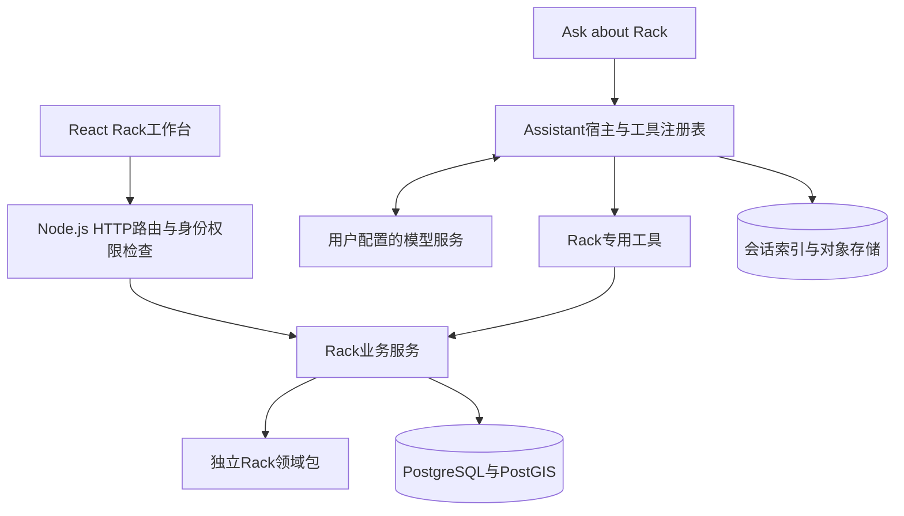
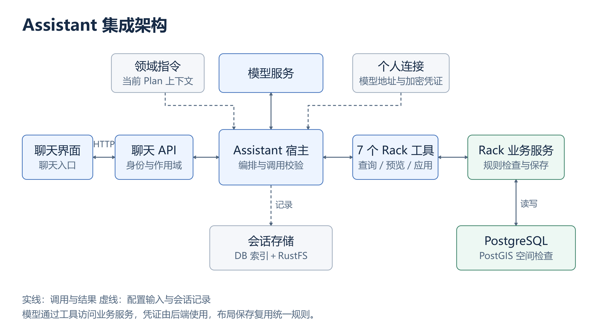
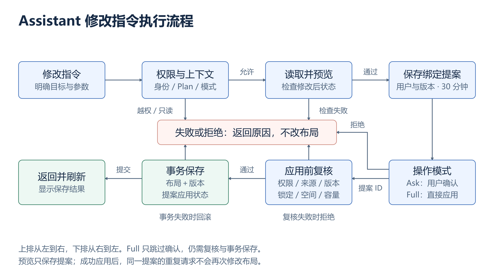

# Rack 课程项目汇报内容完整版

更新日期：2026-10-31。对应 Option 2.2：Rack。

本文提供可以直接整理进 PPT 的页面正文、具体讲解内容、演示步骤，以及 API 和答辩附录。主体20页，适合约18–22分钟，最终以老师规定为准。“页面正文”可直接放入幻灯片，“讲解内容”用于理解和演练，不需要整段塞入页面或逐字朗读。成员姓名和真实贡献是唯一需要小组自行补齐的内容。

实现结论以本地 Rack 副本源码、数据库迁移及 PROGRESS.md 中的实际验证为依据。合成设备参数属于课程规划假设。文中 JSON 使用示意 UUID，不能当作当前数据库中真实对象的标识。

## 第1页：项目目标与最终交付

### 页面正文

**面向数据中心机房的机柜布局与设备分配系统**

- 输入：机房边界、设备型号与数量、空间和资源约束。
- 输出：机柜位置、方向、设备安装位置、容量统计、问题诊断及布局候选。
- 操作：自动生成、人工调整、检查、保存、导出、删除与恢复。
- Assistant：查询当前方案，理解修改请求，通过受控工具完成修改。

选题：Option 2.2 Rack。成员：填写三位成员姓名。

### 讲解内容

我们的项目处理机房内部的物理规划。服务器和交换机是需要安装的设备，机柜提供安装空间，机房提供机柜的实际摆放区域。系统需要同时回答两个问题：设备装在哪个机柜、哪个连续 U 位，以及这些机柜在房间里怎样摆放。

最终交付包括可操作的可视化工作台、规划和检查服务、持久化方案、权限管理以及 Rack Assistant。方案既可以从设备数量自动生成，也可以人工调整。所有修改最终经过后端检查后保存。

## 第2页：用一个具体需求说明规划问题

### 页面正文

示例需求：8台 GPU 服务器、12台计算服务器、2台 ToR 交换机。

| 设备 | 数量 | 单台 U 高 | 单台重量 | 单台功率／冷却需求 |
| --- | ---: | ---: | ---: | ---: |
| GPU server | 8 | 4U | 80kg | 3kW／3kW |
| Compute server | 12 | 2U | 25kg | 0.8kW／0.8kW |
| ToR switch | 2 | 1U | 10kg | 0.3kW／0.3kW |
| 合计 | 22 | 58U | 960kg | 34.2kW／34.2kW |

机柜假设：42U、800kg、12kW功率、12kW冷却上限。仅考虑功率，下界为 `ceil(34.2 / 12) = 3` 柜。

### 讲解内容

如果只检查 U 位，58U 看起来两个42U机柜就够了。但两个机柜只能提供24kW功率，无法满足34.2kW需求。因此，设备分配是多资源装箱问题，空间、重量、功率和冷却必须同时检查。

一种满足资源条件的装箱是：前两个机柜各放4台GPU服务器，每柜16U、320kg、12kW。第三柜放12台计算服务器和2台交换机，共26U、320kg、10.2kW。三个机柜还需要通过房间边界、障碍和维护距离检查，资源上能装下不代表空间上一定能摆下。

当前领域测试在100m×100m合成矩形和给定净距条件下，验证两种装箱策略均保留22台设备并生成3柜。这个测试结论只针对该输入，不代表每个机房都能得到相同结果。

这些数值来自本地演示 Catalog。整机功率是明确声明的假设，不是将电源模块的额定输出简单相加。

## 第3页：设计思想与业务边界

### 页面正文

| 设计选择 | 实际做法 | 解决的问题 |
| --- | --- | --- |
| 输入归属清楚 | Facility拥有机房，Rack拥有方案内的机柜、设备和规划假设 | 避免修改其他工具的数据 |
| 一个Plan对应一个HALL | 创建时绑定机房、场景和来源版本 | 避免混用房间坐标和预算 |
| 固定输入快照 | 记录本次规划采用的边界、孔洞和坐标框架 | 能解释方案使用了什么输入 |
| 共用规则和保存服务 | 手工、算法、Assistant最终接受相同检查 | 防止不同入口得到不同结论 |
| 明确未知值 | `null`是未知，`0`是明确为零 | 防止缺失参数被当成无限容量 |

### 讲解内容

我们按数据所有权划分模块。Rack可以读取Facility的HALL边界，但不能为了让机柜摆得下而修改房间。机柜位置、设备安装和假设预算由Rack方案管理。Network的链路拓扑、Power的供电系统仍属于对应工具。

采用快照后，方案拥有稳定的坐标和来源依据。如果上游Facility输入发生变化，系统会识别来源过期，要求用户处理输入关系，而不是悄悄用新房间边界解释旧机柜位置。

检查结果还保留“哪些内容没检查”。缺少冷却数据时，系统显示未知，不会因为没有报错就宣称方案工程可行。

## 第4页：已有基础、项目贡献与成员分工

### 页面正文

| 平台已有基础 | 本项目新增、扩展或集成的Rack能力 |
| --- | --- |
| 工作区、导航、Inspector和通用交互框架 | Rack分区、房间画布、机柜拖拽、U位立面和容量表 |
| Facility机房、场景及版本数据 | Rack Plan、固定快照、机柜和设备数据及来源检查 |
| 身份校验、RBAC与租户事务基础 | Rack读写／删除／恢复权限、项目成员管理和保护规则 |
| 通用Assistant宿主和模型适配框架 | Rack领域指令、7个工具、持久化修改提案和3种操作模式 |
| 数据库和对象存储基础 | Rack迁移、检查记录、布局事务和JSON／CSV导出 |

### 讲解内容

项目是在提供的平台框架上完成Rack方向的设计与实现。我们复用了平台已有的身份、工作区和Assistant运行框架，并围绕机柜规划补充领域模型、规则、算法、持久化和交互。汇报时应通过这些实际新增行为说明工作量，不把整个基础平台描述为小组从零开发。

成员贡献需要按真实参与填写，区分设计、编码、集成、审阅和测试。统一由一个人提交代码，也不能据此推断所有工作由一个人完成。

| 成员 | 真实完成的工作 | 对应证据 | 本人需要能解释的细节 |
| --- | --- | --- | --- |
| 姓名1 | 根据实际记录填写 | 文件／讨论／联调／测试记录 | 根据实际贡献填写 |
| 姓名2 | 根据实际记录填写 | 文件／讨论／联调／测试记录 | 根据实际贡献填写 |
| 姓名3 | 根据实际记录填写 | 文件／讨论／联调／测试记录 | 根据实际贡献填写 |

这部分不能从现有文件可靠推断，因此不代填姓名或虚构开发分工。工具辅助情况也应如实说明。

## 第5页：软件架构与模块职责

### 页面正文



| 层 | 主要代码位置 | 职责 |
| --- | --- | --- |
| Web | `apps/web/src/rack/` | 草稿、画布、表单、候选比较、Inspector |
| HTTP | `apps/api/src/routes/rack.js` | 接口、权限、请求头和响应封装 |
| 业务服务 | `apps/api/src/services/rack-*.js` | 来源、版本、事务、PostGIS和工具组合 |
| 领域包 | `packages/rack/src/` | 输入规范化、U位／资源规则、装箱和规划逻辑 |
| Assistant框架 | `packages/assistant/src/` | 模型循环、工具执行、确认、会话和用量 |

### 讲解内容

前端负责交互和未保存草稿。后端决定用户能否操作，以及布局是否允许保存。领域包提供不依赖前端、数据库或网络的规则与规划逻辑，便于单独测试。

实际多边形几何检查由业务服务调用PostGIS完成。这样，前端拖拽的结果、算法候选和Assistant修改都能用真实边界进行复核。Assistant没有独立的数据库写入通道，它调用Rack服务，复用正常保存流程。

本地环境中Web和API运行在宿主机，PostgreSQL/PostGIS与RustFS对象存储由独立Compose启动。目前主要业务在一个API进程中完成，没有实现分布式规划微服务。

## 第6页：可视化工作台与完整使用流程

### 页面正文

| 分区 | 已实现内容 |
| --- | --- |
| Plans | 创建、选择、重命名、软删除和恢复方案 |
| Inputs & impact | 查看固定机房输入、来源和修改依赖 |
| Rack layout | 格点房间画布、添加／移动／旋转／锁定机柜 |
| Space rules | 禁放矩形、前后维护距离 |
| Devices & U slots | 型号、设备清单、安装关系和U位立面 |
| Capacity | 每柜U位、重量、功率、冷却及机房假设预算 |
| Layout options | 需求驱动生成、已有机柜重排和候选比较 |
| Checks | 当前检查、保存检查历史和资料下载 |

### 讲解内容

新用户先选择项目、场景和Facility版本，再选择一个HALL创建Rack Plan。之后可以输入设备数量和约束生成候选，查看候选图面和诊断，确认转为草稿，再保存。

画布使用房间局部米制坐标和格点背景。用户可以点击机柜查看位置、型号和负载，进入U位视图查看设备安装，也可以拖拽调整未锁定机柜。平面、立面和容量表使用同一方案数据，便于从整体布局定位到具体设备。

草稿中的移动还没有写入数据库。用户保存后，服务端检查并推进版本。删除Plan采用软删除，管理员可以从已删除列表恢复，机柜和设备内容会保留。

导航中的PARTIAL表示该模块还有明确边界，例如维护带已经实现，但连续疏散通道尚未实现，不表示整个分区只是空页面。

## 第7页：核心数据模型与数据契约

### 页面正文

| 对象 | 主要字段 | 业务含义 |
| --- | --- | --- |
| Plan | planId、projectId、scenarioId、version、facilityInput | 方案身份、作用域与来源 |
| Snapshot | snapshotId、boundaryLocalM、sourceCrs、originProjectedM | 固定机房边界及坐标依据 |
| RackModel | widthM、depthM、heightU、资源上限 | 机柜型号规格 |
| Placement | rackId、modelId、xM、yM、rotationDeg、locked | 机柜实例及位置 |
| Device | deviceId、heightU、资源需求、rackId、startU、catalogRef | 设备及安装关系 |
| Constraints | obstacleCoverage、obstacles、clearance、source | 空间假设和覆盖程度 |
| Equipment | coverage、devices、rackLimits、roomBudget、source | 库存和容量假设 |

### 讲解内容

型号与实例分开：多个机柜实例可以引用同一型号，位置和锁定状态属于实例。设备通过`rackId`引用本方案中的机柜，通过`startU`描述安装起点。例如一台4U设备从U5安装，占据U5到U8，区间两端都包含。

未分配设备的`rackId`和`startU`都为null，仍属于库存。设备总数不会因为装不下而减少。使用Catalog时，`catalogRef={modelId,version}`固定型号版本，后端校验设备规格与该版本一致，不能保留型号引用却私自修改功率。

几何使用有限数值的米，重量用kg，功率和冷却用kW，U位是整数。机柜坐标是占地中心，方向为0／90／180／270度。支持的UTM多边形通过减去投影原点转换到局部坐标，保留内部孔洞，不支持的坐标输入不会被随意变成矩形。

契约同时约定字段、单位、允许值、引用关系和失败行为。例如字符串`"3"`不能代替数值3，未知字段被拒绝，设备引用其他Plan中的机柜也不能通过。

## 第8页：数据实际保存在哪里

### 页面正文

| 数据 | 实际存储位置 | 保存方式 |
| --- | --- | --- |
| 方案和版本 | PostgreSQL `rack_plans` | 每Plan一个聚合根 |
| 机房快照 | `rack_room_snapshots.document` | 固定输入JSON文档 |
| 机柜实例 | `rack_placements` | 行记录，关联Plan和型号 |
| 机柜型号 | `rack_models.definition` | 服务端维护的JSONB规格 |
| 设备、柜限制、房间预算 | `rack_plans.equipment` | JSONB，和布局原子保存 |
| 禁放区和维护距离 | `rack_plans.spatial_constraints` | JSONB，共享Plan版本 |
| 保存命令与幂等记录 | `rack_layout_commands` | 请求哈希、执行版本、操作者 |
| 已保存检查 | `rack_check_runs` | 绑定版本与输入的不可变检查记录 |
| Assistant修改提案 | `rack_assistant_proposals` | 所属用户、精确修改体、有效期和应用状态 |

### 讲解内容

布局数据主要保存在PostgreSQL，而不是浏览器或代码文件。采用JSONB保存设备和约束，是因为它们与Plan共享版本、检查和事务边界。机柜实例单独成表，便于明确实例与型号、方案之间的关系。后续如果需要跨方案查询大量设备，可以再评估设备独立建表。

浏览器内存只保存未保存草稿。算法候选是临时计算结果，目前没有候选历史表。关闭页面可能丢失未保存草稿，但已保存方案会随数据库持久化。

Assistant会话分两部分存储：`assistant_sessions`和`assistant_turns`保存索引，压缩后的对话内容通过对象存储适配器保存，本地使用RustFS。模型连接使用仓库外的本地文件：默认Windows目录为`%LOCALAPPDATA%/AI-INFRA-Rack/assistant-connections`，加密主密钥放在独立的`assistant-keys`目录。API Key不放入布局表或浏览器localStorage。

本地Compose通过`rack-db-data`和`rack-object-data`持久化数据库与对象内容。团队成员拉取代码能获得实现和迁移，数据库示例内容及各自的模型连接需要单独初始化，不能认为Git会同步运行中的数据库。

## 第9页：约束检查与依赖关系

### 页面正文

| 类别 | 已检查的内容 | 代表性诊断／错误 |
| --- | --- | --- |
| 房间空间 | 实际Polygon边界、孔洞、柜间重叠、禁放区 | RACK_OUTSIDE_ROOM、RACK_PAIR_OVERLAP |
| 维护空间 | 按朝向计算前后维护带，检查越界和侵入 | CLEARANCE_RACK_CONFLICT |
| 安装空间 | 连续U位、安装高度、区间重叠 | DEVICE_U_OVERLAP |
| 资源容量 | 每柜重量、功率、冷却，房间假设预算 | RACK_CAPACITY_EXCEEDED、ROOM_BUDGET_EXCEEDED |
| 引用和依赖 | 型号版本、设备所属柜、删除后的悬空引用 | 输入／引用契约错误 |
| 编辑前提 | 账号权限、来源、快照、Plan版本和锁定状态 | 403、409、412 |

### 讲解内容

房间检查使用真实多边形。机柜在房间包围矩形内，仍可能落在凹陷或孔洞中，因此房间长乘宽不足以判断可行性。外墙接触可以满足包含关系，柜间仅边缘接触不等于内部重叠；孔洞和禁放区接触采用更保守的相交规则。

维护带由机柜朝向决定。旋转机柜之后，前后维护空间也会改变。因此移动或旋转会影响空间检查，调整设备安装关系会影响U位和资源检查，修改预算则影响容量结论。

例如4U设备A从U5安装，占U5–U8，设备B从U8开始就发生重叠。一个12kW机柜再加入设备后达到12.1kW也会报容量冲突。如果某台设备功率未知，总功率不能写成已知小计，而应保留未知标记。

当前存在一项需要完善的限制策略：普通设备检查在存在Plan级柜限制时采用该限制，需求装箱则同时受到已知型号上限约束。两条路径的有效上限策略尚未完全统一，不能声称所有入口都实现了同一种型号硬上限政策。

## 第10页：主体算法怎样生成较优布局

### 页面正文

**按数量设计分成装箱和物理布置两个阶段。**

| 阶段 | 当前实现 | 输出 |
| --- | --- | --- |
| 需求展开 | 服务端解析固定Catalog版本，按数量创建设备实例 | 完整设备清单和稳定标识 |
| 多资源装箱 | Input First Fit和Dominant Best Fit | 机柜分组、设备U位及未分配原因 |
| 物理搜索 | 枚举行列组合与方向，在房间内有限平移搜索 | 机柜位置候选 |
| 完整复核与排序 | PostGIS及设备规则复核 | 指标、可采用状态和诊断 |

排序：优先没有未完成项，再比较已分配设备数、机柜数和机柜包围面积。

### 讲解内容

First Fit按输入顺序处理设备，选择第一个满足U位、重量、功率和冷却条件的机柜，必要时新建机柜，直到达到数量上限。

Dominant Best Fit先计算设备在各容量维度的占比，按最大占比从高到低处理。对于可装入的机柜，选择放入后归一化剩余资源总量较小的一个。这样优先处理更难放的大设备，但它仍是贪心启发式，不保证每次优于First Fit。

装箱后枚举紧凑矩阵的列数和0／90度方向，把维护距离加入行间距，在房间范围内尝试中心、角点及有限比例网格平移。包围范围只提供候选位置，真正是否可行由实际Polygon检查决定。

候选按以下次序比较：首先区分是否存在未完成项，其次最大化已分配设备数，再最小化机柜数量，最后缩小机柜本体的轴对齐包围面积。面积指标不包含维护带，但维护带仍约束可行性。更小的包围面积不能直接解释为释放了相同面积的可用机房空间。

设计路径目前要求空Plan，最多128台设备、32个生成机柜，每种装箱策略最多尝试256个整体布局。`NO_COMPACT_LAYOUT`表示预算内没找到接受的紧凑布局，不构成不可行性的数学证明。

## 第11页：另外两类算法与人工调整

### 页面正文

| 使用场景 | 算法行为 | 保留的内容 |
| --- | --- | --- |
| 已有机柜重新布局 | row-scan-v1／largest-first-v1，有界网格位置搜索 | 已锁定机柜、设备安装和U位 |
| 待分配设备自动上架 | 按U高度降序，扫描未锁定机柜中的连续空隙 | 已安装设备和全部机柜坐标 |
| 人工调整 | 拖拽、旋转、添加或调整设备 | 经同一保存规则复核 |

自动处理失败会保留设备并返回原因，例如未知资源、没有连续U位、容量不足或柜数达到上限。

### 讲解内容

需求驱动设计用于从零生成。已有机柜重排用于房间里已经有机柜，希望比较位置方案。算法不能移动已保存的锁定机柜，也不会顺带重排设备。默认网格步长0.5m，可配置0.1–5m。

自动上架只处理`rackId=null`的设备。它按高度降序寻找连续空隙，同时复核重量、功率、冷却和已配置的房间预算。一个机柜总共剩余4U，如果分成两个不相连的2U空隙，仍不能安装一台4U服务器。

这些路径都有独立的搜索上限：重排最多64个可移动柜，自动上架最多128台待分配设备和64个未锁定目标柜。能保存128柜示例，不代表所有算法都支持一次优化128个可移动柜。

生成候选不会直接覆盖数据库。用户查看图面、指标和未完成项后，才将候选转为共享草稿，再使用普通保存。这保留了人工判断和调整空间。

## 第12页：核心API及前后端交互

### 页面正文

设`P=/api/v1/projects/:projectId/rack/plans/:planId`。

| 请求 | 用途 | 是否改变持久化状态 |
| --- | --- | --- |
| POST `/api/v1/projects/:projectId/rack/plans` | 创建Plan | 是 |
| GET `P/layout` | 读取一致的已保存布局 | 否 |
| POST `P/layout/design-options` | 按数量生成候选 | 否 |
| POST `P/layout/options`／`equipment-options` | 重排／自动上架 | 否 |
| POST `P/layout/check` | 检查提交的布局 | 否 |
| PUT `P/layout` | 原子保存布局 | 是 |
| POST `P/check-runs` | 记录保存版本的检查证据 | 是，Plan版本不变 |
| GET `P/report` | 获取当前保存方案的导出资料 | 否 |
| DELETE `P`／POST `P/restore` | 软删除／恢复Plan | 是 |

### 讲解内容

请求契约包含业务字段和前提。保存请求体包括`contract_version`、`snapshot_id`、`placements`、`constraints`和`equipment`。`If-Match: "3"`表示客户端基于Plan版本3进行保存，`Idempotency-Key`表示这一次命令的身份。

生成接口返回候选、指标、诊断和普通保存体，并标记`persisted:false`。用户点击采用并保存，才调用PUT。POST不一定意味着写数据库，规划POST只是接收较复杂输入的计算。

响应使用`data`封装。保存成功会返回最新布局、ETag，以及`meta.replayed`和`meta.applied_version`。失败通过HTTP状态及`code/message/details`表达，关联标识可用于排查。

例如未授权写入返回403，来源或快照不匹配返回409，Plan版本落后返回412，明确的空间或资源冲突返回422。候选里`canStage=true`只说明候选满足当前采用条件，不授予保存权限。

附录A给出完整的创建、生成及保存JSON，可以直接截取到PPT。

## 第13页：版本、事务和重复请求怎样保证可靠保存

### 页面正文

| 标识 | 保护对象 | 典型用途 |
| --- | --- | --- |
| Facility revisionId／revisionEtag | 上游房间输入 | 识别来源变化 |
| snapshotId | 本方案捕获的固定输入 | 防止混用机房快照 |
| Plan version | Rack当前保存状态 | 防止并发覆盖 |
| Idempotency-Key | 一次写命令 | 防止重试重复执行 |

保存事务：锁Plan，检查幂等和版本，核对来源与快照，规范化并检查，写机柜和JSONB，推进版本并记录命令。

### 讲解内容

假设两个人都读取版本3。甲先保存，版本变成4。乙仍带`If-Match: "3"`提交时，后端返回412，不覆盖甲的结果。前端保留乙的草稿，用户需要加载新状态后检查冲突，目前没有自动合并协同草稿。

另一种问题是服务器已经保存成功，但客户端没有收到响应。此时用相同请求体和同一幂等键重试，后端识别原命令，返回重放信息，不再增加一次版本。相同键换了请求内容会冲突，不能用一个键表示不同操作。

机柜行、设备和约束在同一事务中更新。任何一项检查失败都会回滚，避免机柜已移动但设备仍指向旧状态。普通保存和Assistant应用提案共用这个机制。

记录检查与保存布局是不同操作。检查记录绑定某个保存版本和输入指纹，不推进布局版本，也不能作为之后所有版本的永久通过证明。

## 第14页：Assistant具体怎样接入项目

### Assistant集成架构图



[可编辑SVG](presentation-assets/assistant-architecture-16x9.svg)。图片为3200×1800，适合单独放入一页16:9 PPT；采用固定排版，避免自动布局拉长图形。

图中实线表示主要调用或结果流，虚线表示指令、连接等辅助输入及会话记录。连接的API Key仅供后端调用模型，不发送给浏览器或写入模型消息。模型提出工具调用，宿主验证后执行；模型没有直接访问数据库的连接。

这张图回答“Assistant由哪些模块组成”。第15页流程图进一步解释“一条修改指令具体怎样执行”。

### 页面正文

**用户的模型连接，固定的Rack业务工具。**

- 首次在Ask about Rack配置Base URL、模型名和API Key，后续复用同账号保存的连接。
- 模型使用兼容Chat Completions及工具调用的接口。
- 后端注入Rack领域指令和当前项目／场景／版本／Plan上下文。
- 模型调用已授权的Rack工具取得事实，后端执行，结果再交给模型解释。
- 会话按用户、工作区、Plan和个人连接等上下文隔离。

### 讲解内容

我们复用通用Assistant宿主，在`apps/api/src/assistant-host.js`中注册Rack surface、guide和capabilities。Rack guide规定读后再答、解释未知量、不能声称工程认证、不能把模型文字当成保存成功。

浏览器调用`POST /api/v1/assistant/chat`，提交消息、上下文、会话、连接引用和操作模式。后端从认证结果取得用户身份，解析实际项目和选定Plan，筛选工具，再调用该用户的模型。模型返回`tool_calls`后，宿主验证名称、参数和权限，执行工具并将结果写回本轮消息，继续调用模型，直到得到回复、需要确认或达到限制。

浏览器的流式模式使用`?stream=1`接收逐行JSON事件，展示工具轮次和最终结果。模型服务的输出不直接执行SQL，也不能任意修改布局JSON。

所谓“项目专家”来自领域指令、固定数据语义、当前作用域和实时工具。模型可以查当前机柜、设备、容量和诊断，因此回答能落到项目事实。当前没有项目文档RAG、没有微调，也没有自动读取整个代码库，不能声称模型知道全部设计文档。

保存模型配置不会自动发起付费请求。连接测试使用合成消息和测试工具验证兼容性，真实Rack理解质量需要单独验收。

## 第15页：Assistant的7个工具、修改流程和操作模式

### 修改指令执行流程图



[可编辑SVG](presentation-assets/assistant-edit-flow-16x9.svg)。上排从左向右，下排从右向左，中央汇总失败／拒绝分支。图片为3200×1800，适合单独放入一页16:9 PPT。

Full authorization在图中只省略确认卡片，后续重新检查和事务保存完全保留。预览阶段会持久化提案，但不会修改Plan布局。应用失败不会提交部分布局；应用成功后相同提案重复请求会返回原应用结果，不再保存一次。

用户指令有歧义或对象不唯一时，应在生成可执行提案前澄清。图中展示的是目标和参数明确的修改主流程，并不表示所有自然语言输入都能自动得到正确解释。

### 页面正文

| 工具 | 实际用途 |
| --- | --- |
| rack_list_plans | 列出当前场景／版本的方案 |
| rack_read_plan | 读取选中方案的机柜、设备和约束 |
| rack_query_capacity | 计算每柜容量和房间需求 |
| rack_check_saved_layout | 检查当前保存布局 |
| rack_generate_layout_options | 生成已有机柜重排摘要 |
| rack_preview_changes | 检查修改并生成后端提案 |
| rack_apply_changes | 应用指定的后端提案 |

| 模式 | 实际行为 |
| --- | --- |
| Read only | 不提供修改预览和应用工具 |
| Ask for permission | 默认模式，通过确认卡片后保存 |
| Full authorization | 省去逐次确认，仍经过提案与正常保存检查 |

### 讲解内容

以“把A01移动到X=10m、Y=12m”为例。模型先读取当前版本并定位准确对象，再调用`rack_preview_changes`，提交`MOVE_RACK`操作。后端构造完整新状态，检查锁定、空间和设备规则。如果发现冲突，会返回原因而不创建可执行提案。

可应用的提案写入`rack_assistant_proposals`，绑定用户、项目、Plan、基础版本、快照、精确保存体和30分钟有效期。Ask模式显示后端生成的修改摘要。用户确认后，应用工具只接收`proposal_id`，不能临时换成另一份修改。后端再次检查权限、来源、版本和所有保存规则，在同一事务中保存并标记提案已应用。

Full模式只跳过确认卡片。Viewer即使选Full也没有写权限。来源过期、版本改变或移动锁定柜仍会失败。切换Plan、模型、连接、新建对话或刷新后，模式回到Ask。只读模式也会拦截之前留下的确认请求。

目前支持加柜、移动柜、删除空柜、已有设备上架／移动／取消分配、调整前后净距和房间假设预算。聊天不支持解锁、删除Plan、任意创建设备规格，也未直接开放数量驱动设计与自动上架工具。

每轮最多10次Rack工具调用、2次修改预览、1次应用和1次重排生成。成功应用后报告实际保存版本并刷新Rack视图。系统能够限制错误修改的执行，但不能保证模型永远正确理解自然语言。

## 第16页：认证、角色权限与成员管理

### 页面正文

| 能力 | Viewer | Editor | Project administrator |
| --- | --- | --- | --- |
| 读取、临时检查、计算候选 | 是 | 是 | 是 |
| 创建、编辑、重命名和保存 | 否 | 是 | 是 |
| Assistant修改 | 否 | 是，受操作模式约束 | 是，受操作模式约束 |
| 删除／恢复完整Plan | 否 | 否 | 是 |
| 记录保存版本的检查 | 否 | 是 | 是 |
| 管理项目成员 | 否 | 否 | 是 |

关键权限：`rack.read`、`rack.write`、`rack.delete`、`rack.restore`、`facility.read`和`project.member.manage`。

### 讲解内容

认证回答“用户是谁”，权限回答“这个用户在当前项目可以做什么”。本地开发模式通过签名Token和后端验证建立身份，左下角账号切换用于演示不同主体。正式部署需要配置OIDC和浏览器登录，开发切换器不能当作正式登录交付。

默认演示账号中，Dana Whitfield是项目管理员，Ravi Menon是Editor，Mei Lin是Viewer。菜单文字是开发种子信息，实际权限由数据库角色和后端响应决定。账号可以在不同项目持有不同角色，组织／全局授权也可能追加能力，不能只根据职位名称判断权限。

HTTP接口先按路径项目检查权限，Assistant工具执行时也重新检查，数据库事务再通过项目作用域与RLS补充隔离。隐藏前端按钮方便用户理解，直接绕过界面发请求仍会被后端拒绝。

Project access支持给同组织现有账号设置项目角色和暂停状态，使用成员版本避免互相覆盖。后端在事务中重新确认操作者权限，禁止此接口修改自己的成员身份，保护最后一个有效的直接项目管理员，并原子记录访问事件。暂停直接成员资格不等于撤销所有继承权限，组织／全局授予仍需单独考虑。

## 第17页：现场演示的具体步骤与预期结果

### 页面正文

1. 新建空Plan，选定一个HALL，展示来源和快照。
2. 输入第2页的22台设备需求、42U机柜和资源／维护距离，生成并比较候选。
3. 采用一个候选，保存，刷新读取，检查机柜和设备数量。
4. 点击机柜查看Inspector、U位立面和容量，再制造一个可解释的冲突。
5. 展示128柜／944台已安装设备／8台待分配设备的大规模保存案例。
6. 记录检查和导出，展示一次Assistant修改及Viewer拒绝，最后删除并恢复临时Plan。

### 讲解内容

小案例重点展示从需求到保存的链路。生成阶段数据库还没变化，保存后再读取才能证明结果已经持久化。若所选机房的实际空间不能接受3柜布局，应展示真实原因并调整条件，不能仅凭领域矩形测试宣称现场必然生成3柜。

冲突可以用两柜占地重叠，或两台设备占同一U位。展示相应诊断后恢复草稿。大案例重点展示密集布局、负载差异和从全局定位到单柜设备，952台是库存总数，其中944台已安装，不要把待分配设备计入已安装数量。

Checks记录保存版本后，显示空间和设备的独立状态。下载JSON可看到版本、来源和完整规划资料，CSV包含设备安装关系。修改Plan后，旧检查应变为历史记录，不能继续代表当前状态。

Assistant若提前完成真实模型验收，可以发出一个明确、针对未锁定柜的移动指令，查看确认与保存版本。若未验收，就展示实际工具链和脚本测试证据，不能用模拟模型回复冒充真实模型现场效果。删除恢复使用临时Plan。

## 第18页：测试、初步性能与扩展性

### 页面正文

| 实测规模 | 布局读取中位数 | 空间与设备检查中位数 |
| --- | ---: | ---: |
| 32柜，236已安装＋8待分配 | 40.9ms | 511.8ms |
| 128柜，944已安装＋8待分配 | 55.8ms | 555.9ms |

2026-10-31本机Windows、i7-14650HX、Node22.22.1。每项预热1次，随后顺序测量5次HTTP请求。

相关验证记录：Web 65文件／697测试通过，Assistant包90测试通过，连接／Rack Assistant API测试29通过，新增相关真实数据库选择3通过。测试选择有重叠，不相加为总验收数量。

### 讲解内容

测试分三类。领域测试验证资源、区间、输入和确定性算法。HTTP／数据库测试验证权限、来源、版本、幂等、回滚和真实保存。Web测试包含状态逻辑与静态渲染检查。通过构建或静态渲染不代表所有真实浏览器交互已经验收。

上述性能包括开发代理认证、HTTP、数据库检查和序列化。数据只支持课程规模下的初步响应观察。两案例均使用5点Polygon和4个障碍，5次样本不足以形成可靠尾延迟或生产SLA。本次样本没有测量规划搜索、保存、画布渲染或模型响应。

空间枚举量约为`O(R² + R×Z)`，R为机柜数，Z为障碍数，还要考虑多边形复杂度。设备检查约为`O(R + D + ΣDᵢ² + ΣUᵢ)`，其中Dᵢ为每柜设备数，Uᵢ是枚举的占用U位。设备集中到少数机柜，会改变区间比较的成本。

保存上限为256柜／2,048设备，设计上限为32柜／128设备，重排最多64个可移动柜。这些是不同路径的实现上限，不是已验收的生产容量。后续扩展应先测量复杂房间、并发和大响应，再考虑空间索引／批处理、U区间扫描以及独立计算任务，并保持原有版本和规则语义。

## 第19页：潜在安全风险和已有控制

### 页面正文

| 风险 | 已有控制 | 仍需面对的问题 |
| --- | --- | --- |
| 跨用户／跨项目访问 | 身份校验、作用域权限、复合引用、RLS和提案归属 | 生产数据库角色、多实例权限撤销 |
| 模型误解与提示注入 | 限定工具／参数、名称视为不可信数据、提案与保存检查 | 仍可能正确执行了用户并不想要的合法操作 |
| 密钥泄露 | 仓库外AES-256-GCM加密、独立主密钥、响应脱敏 | API运行账号或主机失陷仍可威胁凭证 |
| SSRF | 默认公网HTTPS、DNS检查与地址固定、拒绝重定向 | 内部网关例外和部署出口仍需管理员控制 |
| 覆盖、重复保存 | 版本、事务、幂等、提案重放处理 | 暂无多人草稿自动合并 |
| 资源消耗 | 输入、搜索、耗时和工具次数上限 | 多人负载、花费策略与记录清理未完善 |

### 讲解内容

AI场景最需要区分语言输出和业务授权。设备名称可能包含指令式文字，因此工具返回数据只能作为数据，不能修改权限或跳过检查。即使模型请求Full模式之外的操作，宿主仍只执行已选择且已授权的工具。

模型连接加密降低了磁盘文件直接暴露明文密钥的风险，但主密钥和密文最终仍由API运行账号使用，不能宣传为主机被攻破后仍绝对安全。向外部模型发送工具数据，也需要考虑所选服务的数据处理政策。

DNS和端点检查是为了避免用户输入一个地址后，让API去访问本机或内部敏感服务。默认限制公网HTTPS，内部网关只能由管理员配置明确例外。

审计记录可帮助追查用户、作用域、工具、耗时、结果和关联请求。Full应用记录与逐次确认会区分，但当前尚无完整的用户可见逐修改审计界面，也没有不可篡改的审计存储承诺。

## 第20页：未实现内容、影响与后续优先级

### 页面正文

| 未实现或未完成验收 | 当前影响 | 后续所需工作 |
| --- | --- | --- |
| 连续通道、疏散连通、侧面净距 | 前后维护带通过仍不能证明可达／可疏散 | 通道图、出入口输入和连通性规则 |
| 深度／导轨、楼板承重、热气流、供电冗余 | 容量结论限于当前声明的标量参数 | 厂商规格、结构／电气／热模型和检查器 |
| 跨Plan权威资源预留 | 房间预算是Plan内假设，多个Plan可能重复使用 | Facility资源分配及并发预留协议 |
| 持久化候选与历史布局重建 | 候选临时，检查历史不能恢复历史布局 | 候选和布局版本存储、差异／恢复流程 |
| 正式验证与发布 | validationState仍为NOT_RUN | 版本绑定的验证、审批和发布流程 |
| 真实模型完整验收 | 已验证工具链，不等于真实语言质量通过 | 实际服务上的查询／修改／拒绝测试集 |
| 生产运行验收 | 当前是本地课程平台 | 正式登录、备份恢复、清理、配额和并发测试 |

### 讲解内容

当前已实现Rack主线：从机房输入和设备需求出发，生成并调整机柜布局，检查空间和资源，保存、恢复和导出，并通过权限约束的Assistant查询和修改。

下一步首先完成真实浏览器与模型验收，以及汇报演练。若进一步扩展工程能力，优先补通道可达性和统一限制策略，再考虑跨方案资源预留、正式验证和更强优化。更复杂的物理分析需要相应输入，不能只增加页面就认为已完成。

缺少某些工程扩展不等于老师要求全部实现。我们需要清楚说明选题覆盖范围、当前可证明的效果，以及实现未覆盖能力还需要哪些数据和规则。

## 附录A：可以直接用于API讲解的完整示例

### A1．创建方案

请求：`POST /api/v1/projects/:projectId/rack/plans`，携带UUID格式`Idempotency-Key`。

```json
{
  "contract_version": 1,
  "name": "Presentation Plan",
  "scenario_id": "11111111-1111-4111-8111-111111111111",
  "facility_input": {
    "revision_id": "22222222-2222-4222-8222-222222222222",
    "container_id": "33333333-3333-4333-8333-333333333333",
    "revision_etag": "actual-facility-token"
  }
}
```

`scenario_id`是场景，`container_id`必须引用当前版本中的HALL。创建新对象返回201，完全相同的幂等重试返回200。服务端在支持的几何条件下捕获固定快照。后续从实际响应取得Plan、snapshot和version。

### A2．按22台设备需求生成候选

请求：`POST P/layout/design-options`。基础Plan应为空，使用读取到的版本和快照。

```json
{
  "contract_version": 1,
  "base_version": 3,
  "snapshot_id": "44444444-4444-4444-8444-444444444444",
  "demand": {
    "groups": [
      {"modelId": "demo-gpu-4u", "version": 1, "quantity": 8},
      {"modelId": "demo-compute-2u", "version": 1, "quantity": 12},
      {"modelId": "demo-tor-1u", "version": 1, "quantity": 2}
    ],
    "rackModelId": "10000000-0000-4000-8000-000000000001",
    "maxRacks": 8,
    "rackLimits": {
      "maxWeightKg": 800,
      "maxPowerKw": 12,
      "maxCoolingKw": 12
    },
    "sourceReference": "Course presentation assumptions",
    "gapM": 0.2,
    "constraints": {
      "obstacleCoverage": "UNKNOWN",
      "source": {"kind": "ASSUMED", "reference": "Course spatial assumptions"},
      "obstacles": [],
      "clearance": {"frontM": 1, "rearM": 0.6}
    }
  }
}
```

候选返回算法身份、分配数量、机柜数、包围面积、未分配原因、报告和正常保存体。客户端采用的是返回的候选内容，不能只凭模型说“生成成功”就认为数据库有布局。

### A3．保存接口的数据契约

下面是另一个最小教学例子：一个柜和一台GPU服务器，用于解释字段。真实候选保存时应提交该候选的完整保存体。

请求：`PUT P/layout`。请求头为：

```http
Content-Type: application/json
If-Match: "3"
Idempotency-Key: 77777777-7777-4777-8777-777777777777
```

```json
{
  "contract_version": 1,
  "snapshot_id": "44444444-4444-4444-8444-444444444444",
  "placements": [
    {
      "rackId": "55555555-5555-4555-8555-555555555555",
      "modelId": "10000000-0000-4000-8000-000000000001",
      "name": "A01",
      "xM": 3,
      "yM": 3,
      "rotationDeg": 0,
      "locked": false
    }
  ],
  "constraints": {
    "obstacleCoverage": "UNKNOWN",
    "source": {"kind": "ASSUMED", "reference": "Course spatial assumptions"},
    "obstacles": [],
    "clearance": {"frontM": 1, "rearM": 0.6}
  },
  "equipment": {
    "coverage": "DECLARED_COMPLETE",
    "source": {"kind": "ASSUMED", "reference": "Course equipment assumptions"},
    "devices": [
      {
        "deviceId": "66666666-6666-4666-8666-666666666666",
        "name": "GPU-01",
        "heightU": 4,
        "weightKg": 80,
        "powerKw": 3,
        "coolingKw": 3,
        "rackId": "55555555-5555-4555-8555-555555555555",
        "startU": 1,
        "catalogRef": {"modelId": "demo-gpu-4u", "version": 1}
      }
    ],
    "rackLimits": [
      {
        "rackId": "55555555-5555-4555-8555-555555555555",
        "maxWeightKg": 800,
        "maxPowerKw": 12,
        "maxCoolingKw": 12
      }
    ],
    "roomBudget": {
      "maxPowerKw": 20,
      "maxCoolingKw": 20,
      "source": {"kind": "ASSUMED", "reference": "Course room budget"}
    }
  }
}
```

| 字段或规则 | 应解释的具体含义 |
| --- | --- |
| contract_version | 请求数据格式版本，目前只接受1，与Plan版本不同 |
| snapshot_id | 必须属于该Plan，固定本次几何依据 |
| placements | 保存的完整机柜清单，坐标为柜中心，单位米 |
| clearance | 随方向变化的前后维护距离，不是疏散连通图 |
| coverage与source | 声明输入覆盖程度及假设来源，完整声明不等于认证 |
| catalogRef | 固定设备型号版本，规格必须与服务端Catalog匹配 |
| roomBudget | 只约束该Plan已安装设备的房间假设预算 |
| If-Match | 与当前Rack整数版本比较，不能填Facility的ETag |
| Idempotency-Key | 代表一次命令，相同请求重试复用原键 |

成功响应关键字段是`data.version`、`meta.replayed`和`meta.applied_version`，并携带最新整数ETag。例中若从3首次保存成功，应用版本为4。完全相同重试不再推进版本。

兼容规则：省略`constraints`或`equipment`保留已保存值。提供equipment但省略roomBudget也保留原预算，显式`roomBudget:null`才清空。不能把省略、空数组和null混为一谈。

### A4．临时检查与保存检查

`POST P/layout/check`接收布局输入，返回空间和设备报告，不写布局也不创建历史检查。记录历史用`POST P/check-runs`，携带幂等键：

```json
{
  "contract_version": 1,
  "base_version": 4,
  "snapshot_id": "44444444-4444-4444-8444-444444444444"
}
```

记录接口读取已保存状态，不接受客户端传入一份不同的草稿。检查记录包含版本、快照、输入SHA-256、规则集`rack-scoped-checks/v1`、操作者和报告。保存布局或来源发生变化后，旧记录成为HISTORICAL。记录本身不推进布局版本。

### A5．Assistant修改操作

用户输入自然语言后，模型生成的预览工具参数示例：

```json
{
  "base_version": 4,
  "operations": [
    {"type": "MOVE_RACK", "rack": "A01", "x_m": 10, "y_m": 12}
  ]
}
```

后端预览通过后返回`canApply:true`、`proposalId`、`changes`和检查结果。应用工具只接收：

```json
{
  "proposal_id": "88888888-8888-4888-8888-888888888888"
}
```

名称必须在选中方案中准确唯一。存在同名对象时需要用工具返回的标识澄清，不能随便选一个。修改提案的`persisted:false`表示布局尚未保存，提案本身已经可以持久化。应用成功以工具返回的`persisted:true`及`appliedVersion`为准。

## 附录B：检查状态与错误处理的准确口径

| 状态 | 准确解释 | 不能据此声称的结论 |
| --- | --- | --- |
| ISSUES_FOUND | 已检查范围存在明确冲突 | 全部其他规则都正确 |
| NOT_CHECKED | 没有相关对象或条件，未执行相关检查 | 已通过检查 |
| INCOMPLETE | 存在未知输入、未完成分配或未覆盖规则 | 方案完全可行 |
| CHECKED_SCOPE_CLEAR | 声明的本地检查范围清晰 | 完成工程认证 |
| validationState:NOT_RUN | 没有正式全方案验证运行 | 已验证并可发布 |
| CURRENT／HISTORICAL | 检查与当前输入是否一致 | 方案整体合格与否 |

资源维度单独使用WITHIN_LIMIT、UNKNOWN、EXCEEDED。例如已知功率小计已经超过上限，即使还有设备功率未知，也能判定超限。不存在阻塞诊断但覆盖不完整时，普通保存可以允许继续规划，界面必须保留未检查项。

| HTTP状态 | 具体情况 | 用户应采取的操作 |
| --- | --- | --- |
| 400 | 字段、单位、枚举、参数或操作模式不合法 | 修正输入 |
| 401／403 | 无有效身份或权限不足 | 使用正确身份／授权 |
| 409 | 来源、快照、幂等内容或状态冲突 | 核对来源／状态，不强制覆盖 |
| 410 | Plan已软删除，布局不可访问 | 通过恢复流程处理 |
| 412 | Rack版本已经变化 | 保留草稿，读取后重新审查 |
| 422 | 空间或设备规则明确冲突 | 按诊断修正 |
| 428 | 缺少版本／幂等前提 | 补充请求头 |
| 503 | 规划超时或相关依赖不可用 | 减少工作量或恢复服务，未自动保存结果 |

## 附录C：答辩可以直接采用的回答

### 1．为什么要同时保存Facility版本、快照和Rack版本？

Facility版本和token识别上游输入，snapshot固定当时采用的房间边界，Rack版本识别本方案的编辑状态。房间变化和机柜变化是两类变化，因此不能用一个版本号代替。保存必须同时满足来源、快照与Rack版本条件。

### 2．算法真的在优化吗？为什么不用穷举？

当前是比较明确策略的有界启发式。需求装箱优先完整分配，再比较设备数、机柜数和包围面积。多维装箱叠加带障碍的物理放置，穷举成本很高。我们用确定性策略、搜索预算和普通检查复核控制成本，并明确保留未完成原因，不承诺全局最优。

### 3．3柜例子能不能证明算法总是最优？

不能。该例功率下界就是3柜，测试找到了3柜的资源可行解，因此可以说明该例在柜数目标上达到这个下界。换设备组合、房间或目标后，不能据此推广。物理布局的包围面积也没有得到全局最优证明。

### 4．为什么已经没有红色错误，还显示INCOMPLETE？

没有发现已检查规则的冲突，不代表所有输入和规则齐全。例如障碍覆盖未知、缺少维护距离或资源需求，以及当前未实现的楼板和电气规则，都会限制结论。系统保留覆盖程度，避免把缺失信息解释成通过。

### 5．布局和设备为什么一起保存？

设备依赖机柜身份与U位，预算依赖已安装设备。分开提交容易出现删了柜但设备仍引用它，或者位置和约束来自不同版本。共享Plan版本和事务后，整个聚合同时成功或回滚。

### 6．Assistant为什么了解我们的项目？

宿主为它提供Rack指令、固定工具schema、当前选中方案和权限作用域。实际事实由工具读取已保存数据并调用检查器计算。它通过受控工具理解当前方案，不是自动掌握整个源码。项目文档检索和微调目前没有实现。

### 7．Full authorization是否等于管理员？

不等于。它只改变应用Rack提案前是否弹逐次确认卡片，不改变账号的有效权限。Viewer没有rack.write，仍不能预览或应用修改。即使是管理员，也不能通过该模式跳过锁定、来源、版本或空间资源检查。

### 8．用户点确认时，怎样保证执行的是看到的内容？

后端先保存精确的规范化保存体和修改摘要。确认卡片展示该提案摘要，应用只提交提案ID。服务端检查提案归属和基础版本后执行存储的保存体，而不是要求模型重新生成修改。过期或当前版本改变都会阻止原提案应用。

### 9．确认请求重复发送会不会移动两次？

提案在普通保存事务中记录applied_version。重复或并发应用识别已应用状态，返回原应用版本，不再重复保存。返回还区分应用版本与当前版本，避免方案后来又修改后把两者混淆。

### 10．数据表有RLS，为什么还要后端权限？

项目隔离回答数据属于哪个租户，业务权限回答用户是否能读、写、删或恢复。它们处理不同问题。后端使用实际项目作用域授权，租户事务设置项目上下文并由RLS补充隔离。生产连接角色是否能绕过RLS仍需要部署核查。

### 11．为什么128柜案例不代表所有算法支持128柜？

持久化规模和搜索规模是不同资源预算。大案例用于展示读取、容量、检查和可视化。自动设计最多32柜，重排最多64个可移动柜，自动上架也有目标柜和待分配数量限制。提高上限需要重新测量并验证，而不是只改一个数字。

### 12．检查记录能不能恢复历史布局？

不能。它保存当时的输入指纹、版本和检查报告，不保存每个版本的完整可恢复布局。JSON导出是规划资料，也不是已实现的往返导入或跨工具资源分配协议。

### 13．交换机与Network的区别是什么？

同一个交换机在Rack里关注占几U、装在哪个柜、重量和资源需求。Network关注端口、链路和通信拓扑。目前Catalog中的ToR型号不会自动创建Network链路，展示交换机设备不等于已经实现网络规划联动。

### 14．怎样说明不是直接拷贝已有平台？

明确说明平台提供的框架，再展示Rack方向新增的数据迁移、纯领域规则、三类算法、后端检查保存、交互和专用Assistant工具。通过具体输入、错误案例、源码和测试解释新增行为。成员贡献和工具辅助情况应如实陈述，不能仅凭代码量或界面规模证明原创和理解。

## 附录D：技术定位表

以下是内容核查和答辩定位，不替代前面的汇报正文。

| 技术问题 | 实际文件 |
| --- | --- |
| Rack HTTP接口 | [rack.js](apps/api/src/routes/rack.js) |
| Plan创建和生命周期 | [rack-plans.js](apps/api/src/services/rack-plans.js) |
| 保存、检查和候选业务组合 | [rack-layout.js](apps/api/src/services/rack-layout.js) |
| 需求装箱和紧凑搜索 | [demand-planner.js](packages/rack/src/demand-planner.js) |
| 已有机柜重排 | [planner.js](packages/rack/src/planner.js) |
| 待分配设备自动上架 | [allocator.js](packages/rack/src/allocator.js) |
| 设备、U位和容量检查 | [equipment.js](packages/rack/src/equipment.js) |
| 设备示例参数 | [catalog.js](packages/rack/src/catalog.js) |
| UI分区与能力状态 | [rack-sections.js](apps/web/src/rack/rack-sections.js) |
| Assistant宿主装配 | [assistant-host.js](apps/api/src/assistant-host.js) |
| Rack领域指令和7工具 | [rack-assistant.js](apps/api/src/services/rack-assistant.js) |
| 修改提案预览／应用 | [rack-assistant-edits.js](apps/api/src/services/rack-assistant-edits.js) |
| 模型调用与确认控制 | [orchestrator.js](packages/assistant/src/orchestrator.js) |
| 个人连接与加密 | [assistant-connections.js](apps/api/src/services/assistant-connections.js) |
| 会话数据库／对象存储 | [sessions.js](packages/assistant/src/sessions.js) |
| 数据表和约束 | `data-scripts/007`至`014`对应SQL迁移 |
| 性能原始说明 | [performance.md](records/2026-10-31-rack-delivery-gaps/performance.md) |
| 本文22台设备／3柜的领域测试 | [demand-planner.test.js](packages/rack/src/tests/demand-planner.test.js) |
| 最新测试和验收边界 | [PROGRESS.md](PROGRESS.md)中第36和39轮 |

## 附录E：评分要求对应位置

| 老师要求 | 本文对应内容 |
| --- | --- |
| 设计思想 | 第1–3页 |
| 项目分工 | 第4页，姓名和真实贡献须补齐 |
| 软件架构 | 第5–8页 |
| 核心模块、API、数据contract | 第7–13页，附录A／B |
| Assistant集成 | 第14–15页 |
| 认证／权限管理 | 第16页，第19页 |
| 初步性能／扩展性分析 | 第18页 |
| 未实现内容 | 第20页 |
| 潜在安全风险 | 第19页 |
| 回答细节和解释新增工作 | 贯穿案例，附录C／D |

如果必须缩短到15分钟，可合并第2／3页、第6／17页、第7／8页、第10／11页以及第14／15页，保留所有评分项，API完整JSON和详细答辩材料放备用页。汇报前只需补齐真实成员贡献、核对演示环境，并用自己的话演练具体案例。
