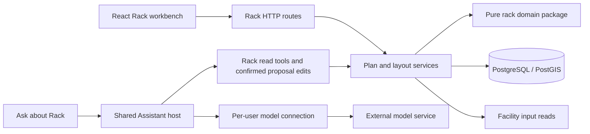

# Rack Planner

The Rack Planner turns a Facility HALL boundary and equipment requirements into reviewable rack layouts and equipment assignments. It implements the course Option 2.2: placement, capacity, equipment allocation, physical constraints, optimization and dependencies. The result must explain why a candidate is acceptable, which constraints were checked and which inputs remain assumptions.

This bundle follows the structure of the [Site and Facility Editor](../site-and-facility/Overview.md), adapted to Rack ownership. **Implementation baseline: 2026-10-30.** Implemented describes inspected source, not production certification. Planned describes future work, not an available endpoint. MUST/SHOULD requirements apply to their stated scope.

## Ownership Boundaries

| Concern | Rack owns | Referenced owner / boundary |
| --- | --- | --- |
| Context | Independent versioned plan for one HALL | Facility owns project/scenario/revision, HALL identity and authoritative Polygon |
| Layout | Rack identities, models, positions, orientations and locks | No edits to Facility geometry |
| Equipment | Plan-local devices, inventory and contiguous U assignments | Not a shared asset registry or Network endpoint database |
| Space rules | Assumed rectangular exclusions and front/rear maintenance clearance | No inferred surveyed obstacles, corridors or evacuation paths |
| Capacity | Per-rack limits and optional plan-local room assumptions | No authoritative Facility allocation, electrical or HVAC design |
| Planning | Packing, bounded layout search, relocation and automatic allocation | Network graph layout is not a physical placement algorithm |
| Assistance | Rack projection of existing read/computation services | Shared Assistant host owns connections, sessions and orchestration |
| Governance | Versions, idempotent writes, soft deletion/restoration, saved scoped check evidence | No formal Rack Validation Run, publication or approvals yet |

The inherited blueprint also assigns room/row concerns to Floorplan. This course implementation owns plan-local rack placements inside a Facility HALL. A platform-wide canonical Floorplan/Rack ownership contract remains an [open decision](decisions.md).

## Core and Peripheral Design Targets

### Core Design Targets

| Target | Implemented result | Evidence boundary |
| --- | --- | --- |
| Physical input | Fixed supported Polygon with holes in local metres | Extent/area never substitute for the actual boundary |
| Arrangement | Dot-grid canvas, drag/nudge/rotate, locks, inspectors, elevations and capacity table | Shared objects and coordinates across views |
| Equipment mapping | Inventory versus installed devices, inclusive U intervals | Devices belong to racks within one plan |
| Constraints | Polygon, overlap, zones, maintenance bands, U and resource checks | Unknowns remain unknown; coverage is explicit |
| Automatic design | Empty-plan quantities and constraints produce two candidates | First Fit and dominant-resource Best Fit plus real Polygon checks |
| Improvement | Existing-rack relocation and unassigned allocation | Preview, explicit stage and ordinary save |
| Persistence | Atomic aggregate save and source/version/snapshot guards | Client preview cannot authorize a write |

### Peripheral Design Targets

| Target | Current behavior | Remaining work |
| --- | --- | --- |
| Traceability | Source/model versions, algorithm IDs, fingerprints, commands, saved checks and JSON/CSV planning reports | Durable candidate history and accepted cross-tool handoffs |
| Collaboration | Authentication, RBAC, isolation, optimistic concurrency | Presence and draft merging |
| Assistant | Five read/computation tools and personal model connection | Demand/allocation projection and real-model acceptance |
| Recovery | Soft deletion, restore, exact retry | Retention policy and restore drills |
| Handoff | Documented input/output boundaries | Accepted Network/Power/Thermal/Verify exports |

## Functions

1. Create, select, rename, delete and restore a HALL-bound plan.
2. Inspect pinned inputs, source freshness and the room boundary.
3. Specify quantities, limits, exclusions, clearance and assumption sources.
4. Generate/compare candidates and explain unplaced items.
5. Edit placement, assign devices, inspect loads and diagnose conflicts.
6. Stage a reviewed candidate and save the shared draft atomically.
7. Ask the Assistant about saved inventory, capacity, checks and relocation options.
8. Record saved-version checks, identify historical results and download planning JSON/equipment CSV.

## Software Architecture

Domain functions normalize values, check equipment and generate deterministic proposals. Services enforce persistence, scope, freshness and authoritative Polygon checks. UI and Assistant consume services; neither accesses the database directly. Not every browser operation has been migrated into the generic named-command registry.

### Implementation Map

| Concern | Source of truth |
| --- | --- |
| Domain exports and invariants | [Rack package](../../../packages/rack/src/index.js) |
| HTTP route/permission matrix | [Rack routes](../../../apps/api/src/routes/rack.js) |
| Plan lifecycle and source identity | [Plan service](../../../apps/api/src/services/rack-plans.js) |
| Polygon checks, previews and atomic save | [Layout service](../../../apps/api/src/services/rack-layout.js) |
| Quantity packing and compact layout | [Demand planner](../../../packages/rack/src/demand-planner.js) |
| Shared draft and browser composition | [Rack editor](../../../apps/web/src/rack/RackEditor.jsx) |
| Model-facing tools and guide | [Rack Assistant projection](../../../apps/api/src/services/rack-assistant.js) |
| Personal connection persistence/security | [Connection service](../../../apps/api/src/services/assistant-connections.js), [endpoint transport](../../../apps/api/src/services/assistant-endpoint.js) |
| Domain verification | [Rack tests](../../../packages/rack/src/tests) |

## Specification Bundle

| Document | Responsibility |
| --- | --- |
| [UI Pattern](ui-pattern.md) | Navigation, canvas, inspector, shared draft and user journey |
| [Interchange Contract](interchange-contract.md) | Pinned inputs, ownership, output and future handoff |
| [Entity Model](entity-model.md) | Shapes, relationships, units and invariants |
| [Storage Shape](storage-shape.md) | Tables, transactions, indexes and recovery |
| [Backend API Contracts](backend-api-contracts.md) | Actual HTTP routes, examples and errors |
| [Tool Surface](tool-surface.md) | Operations shared across transports |
| [Verification Requirements](verification-requirements.md) | Test matrix, gates and evidence |
| [Constraint Catalog](constraint-catalog.md) | Diagnostics and unchecked scope |
| [Import Mapping](import-adapters.md) | Current normalized inputs and future file/vendor adapters |
| [Assistant Integration](assistant-integration.md) | Capabilities, grounding, personal API setup and security |
| [Authentication and Access Control](access-control.md) | Role matrix, lifecycle authority, scoped membership administration and audit |
| [Assistant Edits](assistant-edits.md) | Typed edits, checked server previews, confirmation and atomic save |
| [Saved Checks and Reports](check-history-and-reports.md) | Saved-version evidence, freshness, history and JSON/CSV downloads |
| [Non-Functional Requirements](non-functional-requirements.md) | Limits, performance experiments and operational risks |
| [Decisions and Open Questions](decisions.md) | Implemented choices and unresolved policies |
| [Demand Planning](demand-planning.md) | Algorithm, objectives, budgets and limitations |
| [Reference Observations](reference-observations.md) | Historical UI references and evidence boundaries |

## Implementation Status and Acceptance Criteria

Implemented: fixed snapshots, three workbench views, manual editing, relocation, allocation, demand design, live checks, saved check history, JSON/CSV planning reports, lifecycle and personal Assistant connections. Saved evidence was added on2026-10-31; it does not change whole-plan validation, which remains `NOT_RUN`.

Planned: continuous aisles/evacuation, electrical redundancy, rail/depth compatibility, airflow, floor loading, shared reservations, durable candidates, publication and cross-tool exports. A real provider has not been accepted end to end merely because scripted-provider tests pass.

Acceptance requires create → demand/manual layout → compare → inspect U/layout → stage → save → reload → rename/delete/restore. A stale second browser must be refused. Read-only users must not save. Assistant statements must identify the saved version and evidence limits. See [verification](verification-requirements.md) and the historical [progress log](../../../PROGRESS.md).
