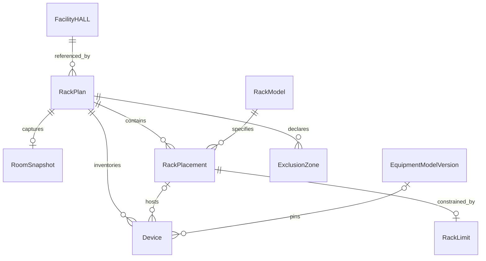

# Rack Planner Entity Model

## Purpose and Terminology

This is the implemented Rack model, not a claim that each entity has an independent table or platform protobuf. Domain code lives in `packages/rack`; HTTP envelopes commonly use snake_case while returned objects use camelCase. Exact route shapes are in [Backend API Contracts](backend-api-contracts.md).

A rack model specifies an instance; a placement positions it; an equipment model/version specifies a device; inventory includes installed and unassigned devices. A snapshot fixes upstream room input. A candidate is temporary computation. A browser editing draft differs from the stored plan's DRAFT lifecycle.

## Relationships

These are logical relationships. Devices/zones/limits are JSONB members today. Unassigned devices remain inventory members.

## Common Value Shapes

Identities are UUIDs except equipment catalog model IDs, which are catalog strings. Names are trimmed nonempty strings up to 160 characters; source references up to 512. Control characters are rejected. Numeric strings are not quantities. Coordinates/dimensions use finite metres; resources use kg/kW and installation uses integer U. `null` is unknown; zero is explicit, never unlimited.

Plan assumption sources currently use `{kind:"ASSUMED",reference:string}`. The rack-model constructor also accepts REFERENCE source records; the current demonstration models remain assumed. `DECLARED_COMPLETE` is a coverage declaration, not survey/vendor certification.

## Plan and Facility Reference

`RackPlan` has `contractVersion:1`, `planId`, `projectId`, `scenarioId`, `name`, integer `version`, `state:"DRAFT"`, `validationState:"NOT_RUN"`, placements and `facilityInput`. Stored metadata adds creator/time and deletion state. Layout reads add models, constraints, equipment, snapshot and source status.

`FacilityInputReference = {projectId,scenarioId,revisionId,containerId,revisionEtag}`. IDs must match scope and container must be a HALL. The opaque, case-sensitive Facility token is not the Rack integer version. Domain comparison can return DIFFERENT_SOURCE; persisted reads expose UNCHANGED/STALE/UNAVAILABLE with ETAG_CHANGED, SOURCE_NOT_DRAFT or ETAG_MISSING reasons.

Deletion sets `deletedAt/deletedBy`; restoration clears them without replacing identity/content. Layout access while deleted is refused.

## Snapshot and Coordinate Frame

`RoomSnapshot = {snapshotId,facilityInput,room,sourceGeometry,view}`. View includes `boundaryLocalM`, `originProjectedM`, `sourceCrs`, `extentM`, `areaM2`, `interiorRingCount`, `unit:"m"`, `frame:"ROOM_LOCAL"`, `transform:"TRANSLATE_ONLY"`.

Supported input: valid 2D WGS84 UTM Polygon, EPSG:32601–32660 or 32701–32760, at most 64 rings/4,096 points and extents up to 10,000m per axis. Translation subtracts outer-ring minimum projected X/Y, preserving holes. It neither rotates to walls nor reprojects arbitrary CRS input. A concave room's local origin may lie outside it. Unsupported input returns a reason rather than an invented rectangle.

## Rack Model and Placement

| Entity | Fields | Invariants |
| --- | --- | --- |
| RackModel | `modelId,name,widthM,depthM,heightU,maxWeightKg,maxPowerKw,maxCoolingKw,source` | Positive dimensions/U; optional unknown resource limits; server-owned specification |
| RackPlacement | `rackId,modelId,name,xM,yM,rotationDeg,locked` | Unique per plan, existing model, rotation 0/90/180/270, edit centre within ±10,000m |

Footprints are centred on xM/yM and preserve physical front/rear orientation. Saved locks protect position/model/rotation/deletion until a separate saved unlock. They are not permissions or approvals. A layout saves at most 256 placements.

## Spatial Constraints

`{obstacleCoverage,source,obstacles,clearance}` uses UNKNOWN or DECLARED_COMPLETE coverage. A rectangle is `{obstacleId,name,xM,yM,widthM,depthM}` with unique UUID, 0.001–10,000m dimensions and centres within ±10,000m; at most 64 rectangles.

Clearance is null or `{frontM,rearM}`, each zero or 0.001–10m. Orientation determines bands. These bands are not continuous corridor entities. Constraints share the placement version.

## Equipment and Capacity

`Equipment = {coverage,source,devices,rackLimits,roomBudget?}` accepts up to 512 devices/256 limit records. Coverage is UNKNOWN or DECLARED_COMPLETE.

`Device = {deviceId,name,heightU,weightKg,powerKw,coolingKw,rackId,startU,catalogRef?}`. Height is 1–100U. Unassigned means both rackId/startU null. Installed means a rack in this plan and inclusive interval `[startU,startU+heightU-1]`; no overlap/out-of-range interval. Unknown resources remain null.

`catalogRef = {modelId,version}` pins server-resolved specifications; a caller cannot retain a binding while substituting specs. Custom devices omit the binding and retain assumed provenance.

`RackLimit = {rackId,maxWeightKg,maxPowerKw,maxCoolingKw}` supplies plan limits; absent records fall back to model values. **Current caveat:** the general checker selects plan assumptions when a record exists, while demand packing takes the minimum of declared and known model limits. A unified policy across all editing paths is an open decision, not an already enforced global rule.

`RoomBudget = null | {maxPowerKw,maxCoolingKw,source}` is plan-local. Installed demand is primary; whole inventory has separate subtotals. Other plans, idle rack power, PUE and upstream allocations are excluded. Resource summaries contain knownSubtotal, nullable total/limit, unknownDevices and WITHIN_LIMIT/UNKNOWN/EXCEEDED status. Room summaries additionally expose nullable remaining capacity; the per-rack checker does not return a separate remaining field.

## Candidates, Diagnostics and Persistence

Candidate results pin base version, snapshot, source and fingerprint; each includes algorithm identity, metrics, unplaced items, stageability and a normal save body. `persisted:false` and `validationState:NOT_RUN` are explicit. No durable candidate table exists.

Reports use ISSUES_FOUND/NOT_CHECKED/INCOMPLETE/CHECKED_SCOPE_CLEAR with diagnostics/unchecked rules. Equipment aggregate and room subreport are separate: absent budget can remain incomplete even when installed-rack checks are clear. Object IDs/units are diagnostic evidence, not whole-plan validation.

One atomic save writes placement, inventory and assumptions under the plan-row lock/version. Failed checks leave all members unchanged; source snapshots never silently advance. Planned entities include durable candidates, version-bound Validation Runs, aisle graphs, cross-tool identities and authoritative allocations; no current tables/endpoints should be invented for them.
