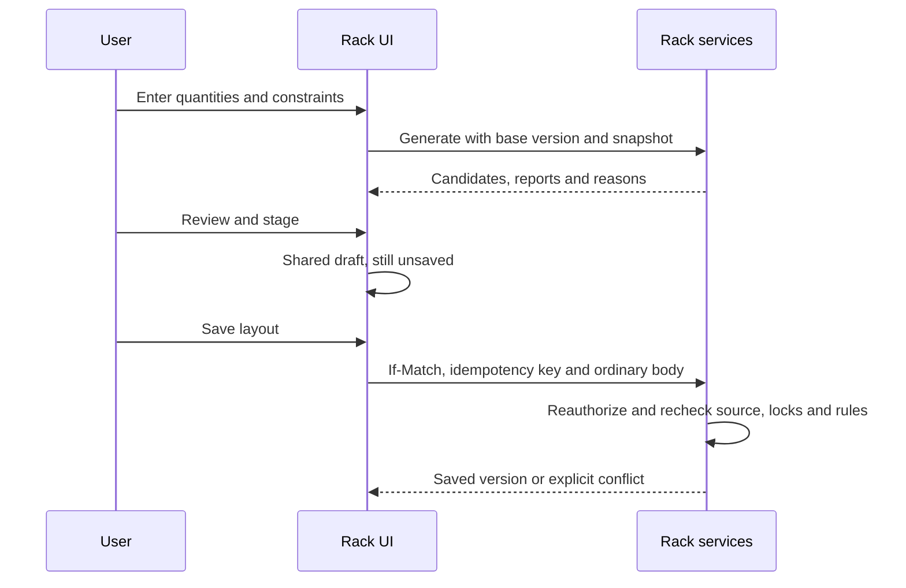

# Rack Planner Interchange Contract

## Purpose and Contract Conventions

This contract defines Facility/Catalog inputs, Rack outputs and future downstream handoffs. Current code uses version-1 JSON/domain objects and HTTP services; there is no completed Rack protobuf publication or compiler artifact. Stable IDs establish identity, names support review, and units/unknowns travel with values.

Requests use `contract_version`, `snapshot_id`, `base_version`; returned objects commonly use `contractVersion`, `snapshotId`, `baseVersion`. Do not assume arbitrary keys can be mechanically renamed. Exact schemas are in [Backend API Contracts](backend-api-contracts.md).

## Input Contract

### Facility Context

| Input | Meaning | Dependency behavior |
| --- | --- | --- |
| Project/scenario | Authorized workspace scope | Client hints cannot grant access |
| Revision/token | Exact Facility revision and opaque ETag | Changed token or non-DRAFT source blocks layout writes/planning |
| Container | Existing HALL in the revision | Missing/foreign/non-HALL input is rejected |
| Boundary | Supported projected Polygon with holes | Unsupported type/CRS/complexity returns an explicit reason |
| Provenance | Source geometry and recorded reference/transform metadata | Synthetic/unreviewed input is not engineering authority |

Rack captures supported input once and compares freshness during later reads. It does not subscribe to Facility events or rebase populated plans automatically. An upstream change leaves the snapshot inspectable. Boundary replacement requires a separately designed migration/review workflow.

### Models, Demand and Assumptions

Rack models are server-owned. Equipment binds exact `{modelId,version}` resolved by the backend. Catalog technology/capability labels do not implement networking or mechanical compatibility. Unknown demands remain unknown.

Demand input contains quantities, rack model/count limit, explicit resource limits, spacing/clearance and provenance. Saved exclusions and room assumptions are retained unless overridden according to [Demand Planning](demand-planning.md). All user-entered zones/limits/budgets remain ASSUMED; missing data is not unlimited or surveyed completeness.

## Output Contract

Saved layout returns project/plan/scenario identity, independent Rack version, snapshot, Facility reference/source status, placements, models, equipment and constraints. Checks return separate spatial/equipment reports and unchecked rules.

| Output | Binding | Consumer obligation |
| --- | --- | --- |
| Saved layout | Plan + version + snapshot | Re-read after mutation; do not confuse with Facility revision |
| Candidate set | Base version, snapshot, fingerprint and algorithm/options | Temporary; stale after relevant changes |
| Candidate body | Ordinary save schema | Review/stage and use authenticated save |
| Metrics | Explicit envelope/movement/assignment definitions | No global-optimum, released-area or engineering claims |
| Unplaced items | Device/rack identity and reasons | Retain every requested item |
| Reports | Scope, diagnostics and coverage | Locally clear is not formally validated |

### Candidate-to-Save Handoff

`canStage` is not authorization and a fingerprint is not a signature. The server validates submitted content again. A source/version conflict requires review/regeneration, not merely replacing the base version to force old content through.

## Lifecycle and Assistant Semantics

Stored lifecycle is DRAFT and validationState is NOT_RUN. Delete/restore changes visibility/access, not validity. No local report can transition a plan to VALIDATED/PUBLISHED because those commands do not exist.

Assistant tools inspect saved inputs and return transient summaries. They do not create racks, transfer candidates to the editor or save. Provider credentials never enter a Rack exchange. Dirty-state hints are not draft content.

## Planned Downstream Interfaces

| Consumer | Useful future output | Missing contract |
| --- | --- | --- |
| Network | Device/rack identities and locations | Accepted endpoint mappings and input versions |
| Power | Installed demand and rack groups | Feed basis, diversity, redundancy and allocations |
| Thermal | Position/orientation and heat assumptions | Containment/airflow model and acceptance criteria |
| Verify | Version, input checksum and coverage | Durable Validation Run, invalidation and retention |
| Cost/Schedule | Model quantities | Owned, versioned quantity handoff; no invented prices |

No current export/subscription implements this table. Future handoffs must pin units/version/source and partial coverage; matching display names cannot merge identities.

## Acceptance Criteria

Foreign references are refused; room holes survive localization/save. Identical pinned inputs produce reproducible candidates. Unknown resources/provenance survive UI/API/Assistant. Generating options writes nothing. Saving uses current permissions and concurrency guards. Future integration requires contract tests before claiming compatibility.
